# 实验报告：基于 RISC-V 的 1024 位无符号整数运算

## 一、基本信息

| 项目 | 内容 |
|---|---|
| 学号 | 3250105856 |
| 姓名 | 郑逸枫 |
| 实验名称 | 基于 RISC-V 的 1024 位无符号整数运算 |
| RARS 版本与模式 | RARS 1.6，RV32 模式（Settings 中关闭 64-bit），允许伪指令 |
| 运行环境 | Windows + WSL2 Ubuntu 24.04，Java: OpenJDK 21.0.12.1（64 位）|
| 提交文件 | `bigint1024.s`（源程序），`实验报告.pdf`（本报告） |

## 二、数据与寄存器设计

### 2.1 数据布局

RV32 的一个字是 32 位，即 4 个字节。一个 1024 位的数要用 32 个字来存，占 128 字节。按“低位字在前”的顺序存放：A[0] 是最低的 32 位，A[31] 是最高的 32 位，所以

`A = A[0] + A[1]×2^32 + A[2]×2^64 + … + A[31]×2^992`

第 i 个字的地址是“首地址 + 4×i”，所以 A[31] 在偏移 124 字节的位置。而乘积 Pro 是 2048 位，要用 64 个字，占 256 字节，所以最高字 Pro[63] 在偏移 252 字节的位置。

所有缓冲区都在 `.data` 段里，用 `.align 2` 保证按 4 字节对齐。由于RARS 默认把数据段放在 `0x10010000`，所以各标签的地址如下。在 Data Segment 窗口按这些地址就能找到结果。

| 标签 | 地址 | 大小 | 内容 |
|---|---|---|---|
| `first_case` | 0x10010000 | 1 字 | 第一个要运行的用例编号，默认 1 |
| `last_case` | 0x10010004 | 1 字 | 最后一个要运行的用例编号，默认 10 |
| `A` | 0x10010008 | 32 字 | 被加数、被减数、被乘数、被除数 |
| `B` | 0x10010088 | 32 字 | 加数、减数、乘数、除数 |
| `Sum` | 0x10010108 | 32 字 | 和 S |
| `Sub` | 0x10010188 | 32 字 | 差 D |
| `Pro` | 0x10010208 | 64 字 | 完整 2048 位乘积 P |
| `Q` | 0x10010308 | 32 字 | 商 |
| `R` | 0x10010388 | 32 字 | 余数 |
| `carry` | 0x10010408 | 1 字 | add1024 的返回值，1 表示加法溢出 |
| `borrow` | 0x1001040c | 1 字 | sub1024 的返回值，1 表示 A < B |
| `status` | 0x10010410 | 1 字 | div1024 的返回值，1 表示除数为 0 |

由于mul乘法分配的内存足够大，不会出现溢出等特殊情况，所以不返回status。

**切换用例：** 把 `first_case` 和 `last_case` 改成1到10中的同一个数，就只运行这一组；默认是 1 到 10 全部运行。10 组输入写在 `load_case` 子程序里，每组对应一个标签 `case_1` 到 `case_10`。

**检查有没有漏写的输出字：** 每组开始前，`load_case` 先把 Sum、Sub、Pro、Q、R 全部填成 `0xa5a5a5a5`。这个值在正确结果里不会刚好出现，所以运行后如果哪个字还是 `0xa5a5a5a5`，就说明函数漏写了这个字。这也能证明结果不依赖缓冲区原来是 0。

### 2.2 寄存器用途

调用约定是函数之间的一套规定：参数放在哪、返回值放在哪、哪些寄存器用完要还原。按任务书要求，a0–a7 和 t0–t6 可以随便改；s0–s11 如果用了，返回前必须恢复成原来的值。

**main**

| 寄存器 | 用途 |
|---|---|
| s0 | 当前用例编号，跨所有函数调用保持不变 |
| a0–a3 | 给运算函数传参数；调用后 a0 是返回值，main 马上把它存到 carry、borrow 或 status |
| a7 | ecall 的服务号：4 打印字符串，1 打印整数，34 按十六进制打印一个字，10 退出 |
| t0 | 临时存放标签地址 |

**add1024 / sub1024**

由于两个函数结构一样，这里合并处理。

| 寄存器 | 用途 |
|---|---|
| a0, a1, a2 | 入口时是 &A、&B、&Sum（或 &Sub），每处理一个字就加 4，指向下一个字 |
| t0 | 还剩几个字没处理，从 32 减到 0 |
| t1 | 进位 carry（减法里是借位 borrow），最后放进 a0 返回 |
| t2, t3 | A[i]、B[i] 和中间结果 |
| t4, t5 | 两步运算各自有没有产生进位（借位） |

**mul1024**

| 寄存器 | 用途 |
|---|---|
| s0 | &B |
| s1 | &Pro |
| s2 | i，正在看 B 的第几位（0–1023） |
| t0–t2 | 循环下标 j 和数组指针 |
| t3 | 64 字累加时的进位 |
| t4–t6, a3, a4 | 累加和移位时的中间值；a3、a4 是两步进位标志 |

**div1024**

| 寄存器 | 用途 |
|---|---|
| s0, s1, s2, s3 | &A、&B、&Q、&R |
| s4 | i，正在处理 A 的第几位（从 1023 往下数到 0） |
| ra | 调用 sub1024 前已保存，返回前恢复 |
| a0–a2 | 调用 sub1024 时传参数 |
| t0–t4 | 下标、地址和中间值 |

除法里要调用 sub1024。被调用的函数可以随意改 a 寄存器和 t 寄存器，所以那些在调用前后都要用的值（各数组地址和 i），我放在 s 寄存器里。

### 2.3 栈帧与保存恢复

栈帧（stack frame）是函数进入时在栈上临时划出来的一块空间，用来放局部数组和要保存的寄存器，返回前再还回去。实验要求 sp 保持 16 字节对齐，所以把每个栈帧的大小都定成 16 的倍数。

- **main**：开头用 `andi sp, sp, -16` 把 sp 对齐到 16 字节。main 最后用 ecall 10 退出，不返回。
- **add1024、sub1024**：叶子函数（leaf function），也就是不再调用别的函数的函数。它们只用 a 寄存器和 t 寄存器，所以不需要栈帧。
- **mul1024**：栈帧 272 字节（= 17 × 16）。

  | 位置 | 内容 |
  |---|---|
  | sp+0 ～ sp+255 | 工作数组 T[64]，存左移中的被乘数 |
  | sp+256, +260, +264 | 保存的 s0, s1, s2 |
  | sp+268 | 空着，用来凑满 16 的倍数 |

- **div1024**：栈帧 160 字节（= 10 × 16）。

  | 位置 | 内容 |
  |---|---|
  | sp+0 ～ sp+127 | 临时数组 D[32]，存 R − B 的结果 |
  | sp+128 ～ sp+144 | 保存的 s0–s4 |
  | sp+148 | 保存的 ra（因为要调用 sub1024） |
  | sp+152 ～ sp+159 | 空着，用来凑满 16 的倍数 |

两个函数都是先从栈上取回保存的寄存器，再把 sp 加回同样的大小，然后 `ret`。div1024 有两个出口（正常结束和除数为 0），两条路径最后都走同一段恢复代码 `div_return`，所以不会漏恢复。


另外，算术函数里没有用 ecall。ecall 只在 main 和打印函数 `print_words` 里使用。

## 三、算法说明

我先用 C 写了一遍四个函数（`bigint1024.c`），确认算法和结果都对，再一段一段翻译成汇编。汇编里每个循环上方写了对应的 C 循环，关键指令后面写了对应的 C 表达式。

下面每种运算都按“思路、流程、C 代码”的顺序来写。C 代码是我写的参考实现，原样贴出。

### 3.1 加法 add1024

核心是回绕（wraparound）机制：寄存器只有 32 位，加法结果超过 32 位时，超出的那一位会直接丢掉，只留下低 32 位。比如 `0xffffffff + 1` 的数学结果是 `0x1_00000000`，但寄存器里只剩 `0`。所以，如果相加后的结果反而比原来的加数小，就说明发生了回绕，也就是产生了进位。

每个字要加三样东西：A[i]、B[i]，以及低一个字传上来的进位。这要分两步：先算 A[i] + B[i]，再加上进位。每一步都可能回绕，只要有一步回绕，就要向高一字进位 1。两步不会同时进位：第一步进位时，结果最大是 `0xfffffffe`，再加 1 不会回绕。

**流程：**

1. carry = 0，从 i = 0（最低字）开始。
2. `partial = A[i] + B[i]`。如果 `partial < A[i]`，说明第一步回绕，记 c1 = 1。
3. `Sum[i] = partial + carry`。如果 `Sum[i] < partial`，说明第二步回绕，记 c2 = 1。
4. `carry = c1 | c2`，把 Sum[i] 写回，carry 留给下一个字。
5. i 加 1，重复第 2–4 步，一共 32 次。
6. 返回 carry：1 表示 A + B ≥ 2^1024，这时 Sum 里存的是和的低 1024 位。

**C 代码：**

```c
uint32_t add1024(const uint32_t* A,const uint32_t* B,uint32_t* Sum){
    uint32_t carry = 0;
    for(int i = 0;i<32;i++){
        Sum[i] = A[i] + B[i];
        if(Sum[i] < A[i]){ // wrap around
            Sum[i] = Sum[i] + carry;
            carry = 1;
        }else{
            Sum[i] = Sum[i] + carry;
            if(Sum[i] < carry){// wrap around
                carry = 1;
            }else{
                carry = 0;
            }
        }
    }
    return carry;
}
```

C 里用 if/else 判断进位：第一步回绕（`Sum[i] < A[i]`）时，carry 直接置 1；否则再看加上 carry 之后有没有回绕。改写成汇编时，我用 `sltu`（无符号小于则置 1）直接算出 c1、c2 这两个 0/1 值，再按位或得到新的 carry，所以循环里没有分支。因为两步不会同时进位，两种写法的结果相同。

### 3.2 减法 sub1024

减法也会回绕：`0 − 1` 在 32 位里变成 `0xffffffff`，相当于本字先向高位借了 2^32 再减。所以我不用真的去改高位的数，只要记下一个借位 borrow，下一个字多减 1 就行。

和加法一样，每个字也分两步：先算 A[i] − B[i]，再减去低一字传来的借位。只要有一步不够减，就要向高一字借 1。

**流程：**

1. borrow = 0，从 i = 0（最低字）开始。
2. `b1 = (A[i] < B[i])`：A[i] 不够减，要借位。然后算 `partial = A[i] − B[i]`。
3. `b2 = (partial < borrow)`：再减去低一字的借位时不够减，只在 partial = 0 且 borrow = 1 时发生。然后算 `Sub[i] = partial − borrow`。
4. `borrow = b1 | b2`，把 Sub[i] 写回，borrow 留给下一个字。
5. i 加 1，重复第 2–4 步，一共 32 次。
6. 返回 borrow：1 表示 A < B，这时 Sub 里是 (A − B) mod 2^1024。

**C 代码：**

```c
uint32_t sub1024(const uint32_t* A, const uint32_t*B, uint32_t* Sub){
    uint32_t borrow = 0;
    for(int i = 0;i<32;i++){
        Sub[i] = A[i] - B[i];
        if(A[i] < B[i]){ // wrap around automatically, need borrow
            Sub[i] = Sub[i] - borrow;
            borrow = 1;
        }else{
            if(Sub[i] < borrow){ // wrap around automatically,need borrow
                Sub[i] = Sub[i] - borrow;
                borrow = 1;
            }else{
                Sub[i] = Sub[i] - borrow;
                borrow = 0;
            }
        }
    }
    return borrow;
}
```

C 版本同样用 if/else 分情况更新 borrow。汇编里用 `sltu` 算出 b1、b2，再按位或得到新的 borrow。

### 3.3 乘法 mul1024：移位累加

思路和手算的竖式乘法一样，只是换成二进制。B 的第 k 位如果是 1，就把“A 左移 k 位”加到结果上；如果是 0，就不加。这些“A 左移 k 位”叫部分积（partial product），把它们全部加起来就是 A × B。

我用一个 64 字的工作数组 T 存“当前左移过的 A”。T 从 A 开始，每看完 B 的一位就整体左移 1 位，所以看到第 i 位时，T 正好等于 A × 2^i。

**流程：**

1. 初始化：Pro 的 64 个字全部清零；T[0..31] = A，T[32..63] = 0。
2. 对 i = 0, 1, …, 1023：
   1. 取出 B 的第 i 位：这一位在字 `B[i/32]` 里，字内位置是 `i%32`。把这个字右移 `i%32` 位，再和 1 做按位与。因为 32 是 2 的幂，`i/32` 用右移 5 位算，`i%32` 用和 31 按位与算，不需要除法指令。
   2. 如果这一位是 1，就把 T 加到 Pro 上。加法用的是和 add1024 一样的两步进位方法，但要加满 64 个字，因为 T 左移后会跑到高 32 个字里。
   3. 不管这一位是不是 1，都把 T 整体左移 1 位：每个字左移 1 位，再把低一个字的最高位接到本字的最低位，即 `T[j] = (T[j] << 1) | (T[j−1] >> 31)`。这一步要从 T[63] 往 T[1] 做，否则低一字会先被改掉，读到的就不是原来的最高位。最后单独把 T[0] 左移 1 位。
3. 返回 0。

A 和 B 都小于 2^1024，所以乘积小于 2^2048，T 左移 1023 次后也不会超出 64 个字，Pro 的 64 个字一定装得下，不需要溢出标志。

**C 代码：**

```c
uint32_t mul1024(const uint32_t* A,const uint32_t* B, uint32_t* Pro){
    uint32_t T[64];
    // Initialize the temporary multiplicand.
    for(int i = 0;i<64;i++){
        Pro[i] = 0;
        if(i < 32)T[i] = A[i];
        else T[i] = 0;
    }
    for(int i = 0;i<1024;i++){
        // Extract the current bit.
        uint32_t bit_i = (B[i / 32] >> (i % 32)) & 1;
        if(bit_i){//Add if the bit is 1.
            uint32_t carry = 0;
            for(int j = 0;j<64;j++){
                Pro[j] += T[j];
                if(Pro[j] < T[j]){
                    Pro[j] = Pro[j] + carry;
                    carry = 1;
                }else{
                    Pro[j] += carry;
                    if(Pro[j] < carry){
                        carry = 1;
                    }else{
                        carry = 0;
                    }
                }
            }
        }
        //Shift the entire T left by 1 regardless of the bit, equivalent to multiplying by 2.
        for(int j = 63;j>0;j--){
            T[j] = (T[j] << 1) | (T[j-1] >> 31);
        }
        T[0] <<= 1;
    }
    return 0;
}
```

C 里把 T 加到 Pro 上的那段 64 字循环，用的是和 add1024 一样的进位判断。汇编里把 `i / 32` 写成右移 5 位，把 `i % 32` 写成和 31 按位与；两步进位同样用 `sltu` 和按位或来算。

### 3.4 除法 div1024：按位长除法

思路和手算的竖式除法一样：从被除数的最高位开始，一位一位“落下来”，接在余数后面；余数够减除数，商的这一位就是 1，并减掉除数；不够减，商的这一位就是 0。

**流程：**

1. 把 Q 和 R 的 32 个字全部清零，同时把 B 的 32 个字按位或起来。如果结果是 0，说明 B = 0：这时 Q 和 R 已经清零，直接返回 1。这样除数为 0 时不会进入循环，也就不会死循环。
2. 对 i = 1023, 1022, …, 0（从最高位到最低位）：
   1. R 整体左移 1 位，方法和乘法里的 T 一样，从 R[31] 往 R[1] 做。
   2. 取出 A 的第 i 位，放进 R[0] 的最低位。这两步合起来就是 `R = 2R + A 的第 i 位`。
   3. 比较 R 和 B：从最高字 R[31]、B[31] 开始往下比。两个字相等时，还看不出谁大，要接着比下一个字；遇到第一个不相等的字，就能决定大小。32 个字全部相等，说明 R = B，也算够减。
   4. 如果 R ≥ B：调用 `sub1024(R, B, D)` 把差放进栈上的临时数组 D，再把 D 复制回 R，并把商的第 i 位置 1：`Q[i/32] |= 1 << (i%32)`。之所以要用临时数组 D，是因为任务书规定 sub1024 的输入和输出缓冲区不重叠，所以我没有让它直接把结果写回 R。
3. 返回 0。

**C 代码：**

```c
uint32_t div1024(const uint32_t* A,const uint32_t* B, uint32_t* Q, uint32_t* R){
    // Use a temporary array to store the subtraction result.
    uint32_t D[32];
    // Use zero to check whether the divisor is zero.
    int zero = 1;
    //Initialize the quotient and remainder.
    for(int i = 0;i<32;i++){
        Q[i] = 0;
        R[i] = 0;
        if(B[i] != 0){
            zero = 0;
        }
    }
    if(zero){
        return 1;
    }

    for(int i = 1023;i>=0;i--){
        //Shift R left by 1 and insert the current dividend bit at the low end.
        for(int j = 31;j>0;j--){
            R[j] = (R[j] << 1) | (R[j-1] >> 31);
        }
        R[0] = (R[0] << 1) | ((A[i/32] >> (i%32)) & 1);

        //Check whether R is large enough to subtract B.
        int greater_equal = 1;
        for(int j = 31;j>=0;j--){
            if(R[j] > B[j]){
                break;
            }else if(R[j] < B[j]){
                greater_equal = 0;
                break;
            }
        }
        //If subtraction is possible, update the quotient and remainder.
        if(greater_equal){
            
            sub1024(R,B,D);
            for(int j = 0;j<32;j++){
                R[j] = D[j];
            }
            Q[i/32] |= 1u << (i%32);
        }
    }
    return 0;
}
```

C 里用 `zero` 标志判断 B 是否为 0；汇编里把 B 的 32 个字按位或起来，结果为 0 就说明 B = 0。C 里的 `greater_equal` 标志，在汇编里没有单独存放，而是用两条 `bltu` 分支直接跳到“相减”或“跳过”。

**循环不变量**（loop invariant），就是每一轮结束时都成立的条件。设 A 的前缀是“A 中已经处理过的那些高位组成的数”，即 A >> i，那么每轮结束时：

- R = (A >> i) mod B，并且 Q 里已经放好的商位组成 ⌊(A >> i) / B⌋；
- 所以 0 ≤ R < B。

为什么每轮最多只要减一次？因为上一轮结束时 R < B，所以新的 R = 2R + 1 位 ≤ 2B − 1 < 2B。减一次 B 之后，R 一定小于 B。

为什么 R 不会超出 32 个字？因为 R 是 A 的前缀除以 B 的余数，所以 R 不会比这个前缀本身大；而这个前缀最多只有 1024 位。所以 R 一直能放在 32 个字里，左移时不会丢掉最高位。

i 减到 0 时，A 的前缀就是 A 本身，所以 Q = ⌊A / B⌋，R = A mod B，满足 A = B × Q + R 且 0 ≤ R < B。

### 3.5 执行次数分析

下面的指令条数是我按代码逐条数出来的（包括 `ret`）。

| 函数 | 循环次数 | 执行的指令条数 |
|---|---|---|
| add1024 | 1 层，32 次 | 固定 420 条 |
| sub1024 | 1 层，32 次 | 固定 420 条 |
| mul1024 | 外层 1024 次；每次里面左移 63 次，若这一位是 1 再累加 64 次 | 597,712 + 772 × k 条，k 是 B 的二进制里 1 的个数。最少 597,712（B = 0），最多 1,388,240（B = M） |
| div1024 | 外层 1024 次；每次里面左移 31 次、比较最多 32 次，够减时再减 32 个字、复制 32 个字 | 除数为 0 时 344 条；否则 346 + Σ(295 + 比较开销) + 659 × q 条，q 是商的二进制里 1 的个数，每轮比较开销 5–256 条。M ÷ 1 时最多，为 1,239,386 条 |

关键是：乘法和除法的外层都固定循环 1024 次，内层也是固定的 32 或 64 次，和 A、B 的数值大小无关。所以不会出现“A 连续加 B 次”或“反复减 B”那种数越大、循环越多的情况，符合任务书的效率要求。

用 RARS 的 Tools → Instruction Counter 也可以统计实际执行的指令数，见图 1。

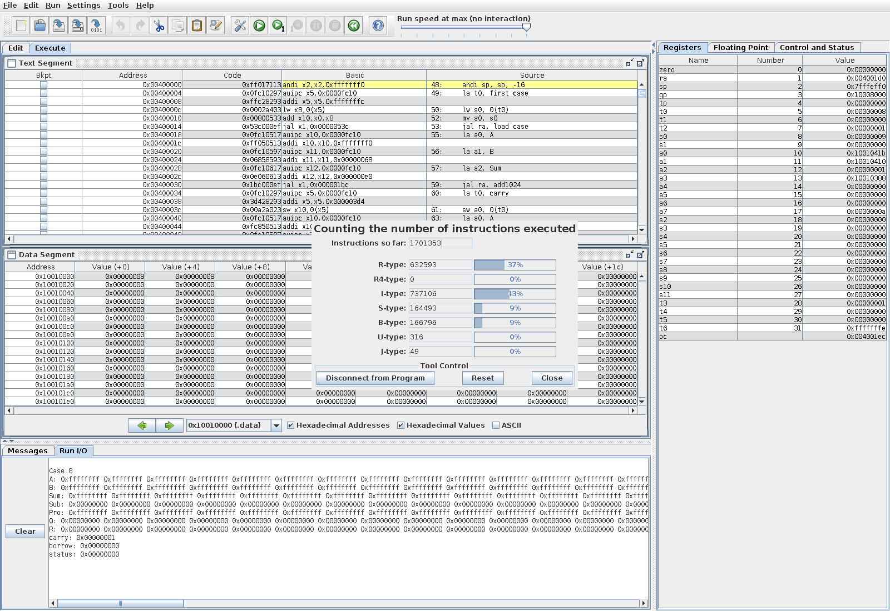

## 四、运行与测试记录

### 4.1 运行方法

1. 在 RARS 中打开 `bigint1024.s`，确认 Settings 里 64-bit 已关闭，然后 Assemble、Run。
2. 默认依次运行第 1–10 组。每组先打印 `Case n`，再打印 A、B、Sum、Sub、Pro、Q、R、carry、borrow、status。
3. 每个数按“从高字到低字”打印，每个字是 8 位十六进制，和平时写数的顺序一样。比如 Sum 那一行最右边的字是 Sum[0]。
4. 只看某一组时，把 `first_case` 和 `last_case` 都改成这一组的编号。

### 4.2 运行结果截图

图 2 是程序在 RARS 中运行后 Run I/O 窗口的输出。全部 10 组的结果整理在 4.3 的表格里。

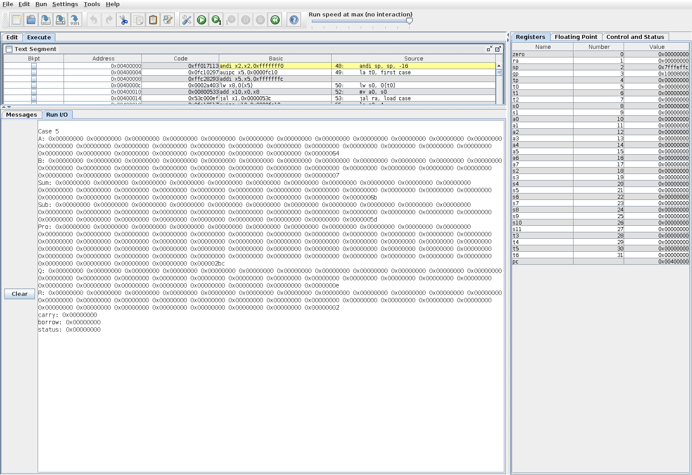

### 4.3 10 组数据的结果对照

记 M = 2^1024 − 1，C = 2^700 + 123456789。下表“实际结果”来自 RARS 运行输出，用“非零的字”来写：例如 `[21]=0x10000000` 表示第 21 个字（从 0 数起）是 0x10000000，没列出的字都是 0。

C 的存放方式：700 = 21 × 32 + 28，所以 2^700 是第 21 个字的第 28 位，即 `[21]=0x10000000`；123456789 = 0x075bcd15，在第 0 个字。

**表 1 加法和减法**

| 编号 | A | B | 期望 S / carry | 实际 Sum / carry | 期望 D / borrow | 实际 Sub / borrow | 结论 |
|---|---|---|---|---|---|---|---|
| 1 | 0 | 1 | 1 / 0 | [0]=0x00000001 / 0 | M / 1 | 32 个字全为 0xffffffff / 1 | 一致 |
| 2 | 1 | 0 | 1 / 0 | [0]=0x00000001 / 0 | 1 / 0 | [0]=0x00000001 / 0 | 一致 |
| 3 | C | C | 2C / 0 | [0]=0x0eb79a2a，[21]=0x20000000 / 0 | 0 / 0 | 全 0 / 0 | 一致 |
| 4 | 100 | 4 | 104 / 0 | [0]=0x00000068 / 0 | 96 / 0 | [0]=0x00000060 / 0 | 一致 |
| 5 | 100 | 7 | 107 / 0 | [0]=0x0000006b / 0 | 93 / 0 | [0]=0x0000005d / 0 | 一致 |
| 6 | M | 1 | 0 / 1 | 全 0 / 1 | M−1 / 0 | [0]=0xfffffffe，[1..31]=0xffffffff / 0 | 一致 |
| 7 | 2^992 | 1 | 2^992+1 / 0 | [0]=0x00000001，[31]=0x00000001 / 0 | 2^992−1 / 0 | [0..30]=0xffffffff / 0 | 一致 |
| 8 | M | M | M−1 / 1 | [0]=0xfffffffe，[1..31]=0xffffffff / 1 | 0 / 0 | 全 0 / 0 | 一致 |
| 9 | 5 | 9 | 14 / 0 | [0]=0x0000000e / 0 | M−3 / 1 | [0]=0xfffffffc，[1..31]=0xffffffff / 1 | 一致 |
| 10 | 2^1023 | 3 | 2^1023+3 / 0 | [0]=0x00000003，[31]=0x80000000 / 0 | 2^1023−3 / 0 | [0]=0xfffffffd，[1..30]=0xffffffff，[31]=0x7fffffff / 0 | 一致 |

**表 2 乘法（Pro 共 64 个字）**

| 编号 | 期望 P | 实际 Pro | 结论 |
|---|---|---|---|
| 1 | 0 | 64 个字全 0 | 一致 |
| 2 | 0 | 64 个字全 0 | 一致 |
| 3 | C² = 2^1400 + 123456789×2^701 + 15241578750190521 | [0]=0x9738a3b9，[1]=0x00362622，[21]=0xa0000000，[22]=0x00eb79a2，[43]=0x01000000 | 一致 |
| 4 | 400 | [0]=0x00000190 | 一致 |
| 5 | 700 | [0]=0x000002bc | 一致 |
| 6 | M | [0..31]=0xffffffff，[32..63] 全 0 | 一致 |
| 7 | 2^992 | [31]=0x00000001 | 一致 |
| 8 | M² = 2^2048 − 2^1025 + 1 | [0]=0x00000001，[32]=0xfffffffe，[33..63]=0xffffffff | 一致 |
| 9 | 45 | [0]=0x0000002d | 一致 |
| 10 | 2^1024 + 2^1023 | [31]=0x80000000，[32]=0x00000001 | 一致 |

第 3 组的对应关系：2^1400 中 1400 = 43 × 32 + 24，所以是 `[43]=0x01000000`；123456789×2^701 跨在第 21、22 两个字上；15241578750190521 = 0x003626229738a3b9，占第 0、1 两个字。第 3、8、10 组的乘积都超过了 1024 位，高 32 个字里确实有非零的值，说明高位没有丢。

**表 3 除法**

| 编号 | 期望 Q | 实际 Q | 期望 R | 实际 R | 期望 / 实际 status | 结论 |
|---|---|---|---|---|---|---|
| 1 | 0 | 全 0 | 0 | 全 0 | 0 / 0 | 一致 |
| 2 | 0 | 全 0 | 0 | 全 0 | 1 / 1 | 一致 |
| 3 | 1 | [0]=0x00000001 | 0 | 全 0 | 0 / 0 | 一致 |
| 4 | 25 | [0]=0x00000019 | 0 | 全 0 | 0 / 0 | 一致 |
| 5 | 14 | [0]=0x0000000e | 2 | [0]=0x00000002 | 0 / 0 | 一致 |
| 6 | M | 32 个字全为 0xffffffff | 0 | 全 0 | 0 / 0 | 一致 |
| 7 | 2^992 | [31]=0x00000001 | 0 | 全 0 | 0 / 0 | 一致 |
| 8 | 1 | [0]=0x00000001 | 0 | 全 0 | 0 / 0 | 一致 |
| 9 | 0 | 全 0 | 5 | [0]=0x00000005 | 0 / 0 | 一致 |
| 10 | (2^1023−2)/3 | [0..30]=0xaaaaaaaa，[31]=0x2aaaaaaa | 2 | [0]=0x00000002 | 0 / 0 | 一致 |

第 10 组：二进制 `1010…10` 除以 3 的商在十六进制里就是一串 `a`，最高字是 `0x2aaaaaaa`。可以验算：3 × Q + 2 = 2^1023。第 2 组除数为 0，Q 和 R 的 32 个字都被清成 0，status = 1，也没有死循环。

10 组全部和期望值一致，没有失败项。另外，我用 C 版本（`bigint1024.c`）跑了同样的 10 组，输出在 `results.txt` 里，和汇编版的结果完全相同。

### 4.4 输入保持、寄存器和栈的检查

1. **输入保持不变**：main 在四个函数全部算完之后才打印 A 和 B，打印出来的 A、B 和 `load_case` 放进去的值相同（见 4.3 的输入列和截图）。所以四个函数都没有改动输入。
2. **输出写全**：输出缓冲区开始前都填了 `0xa5a5a5a5`，10 组的输出里都没有再出现这个值，所以每个输出字都被函数写过。乘法 64 个字都打印出来了，包括高位的 0。
3. **寄存器和栈恢复**：s0 存着用例编号，要跨过全部函数调用。如果哪个函数改坏了 s0，用例编号就会乱掉；实际运行中 10 组按 1 到 10 的顺序完整跑完。另外，我在 main 里调用 div1024 的前后各停一次，比较 sp 和 s0–s4（图 3a、3b）。两张图里 sp 都是 0x7fffeff0，s0–s4 也完全相同。div1024 内部会把 s0–s4 改成各数组的地址，sp 也会减去 160，但返回前都恢复了。图 3c 是 mul1024 返回后的寄存器，a0 = 0。

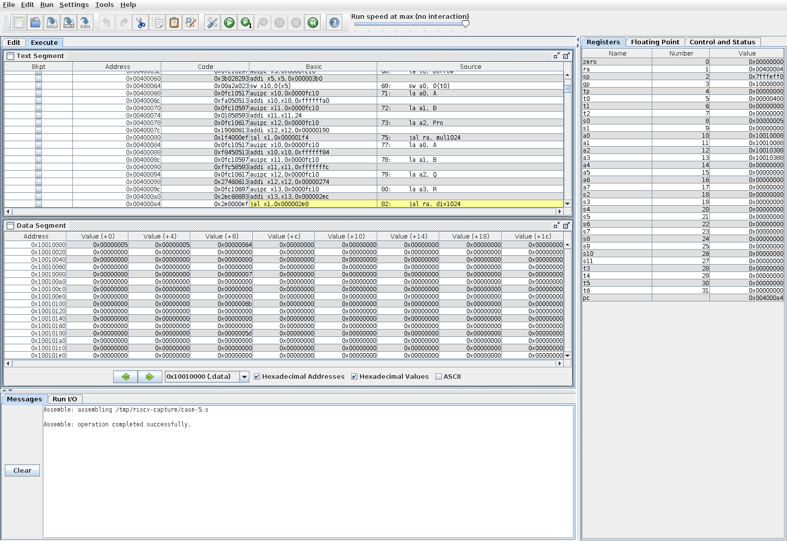

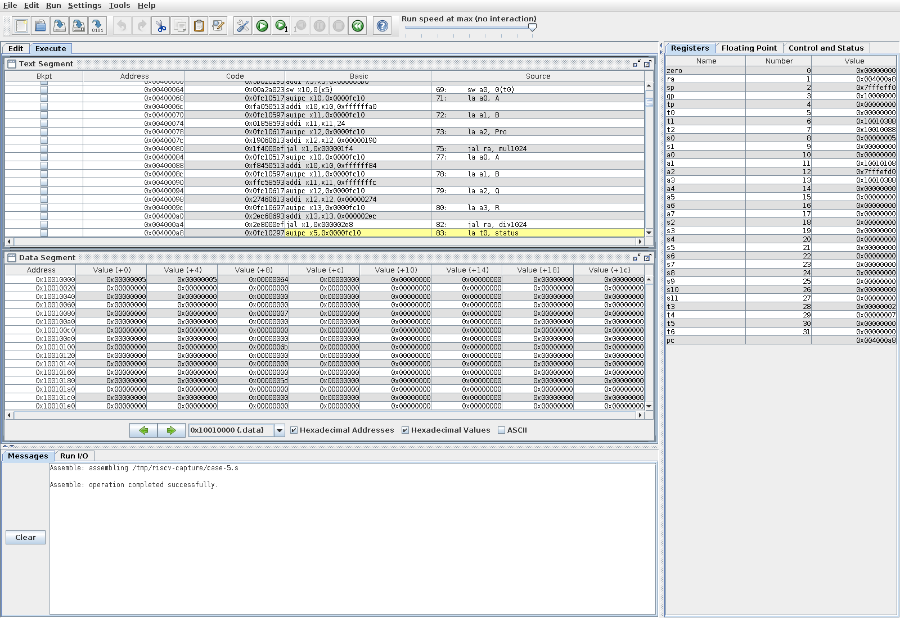

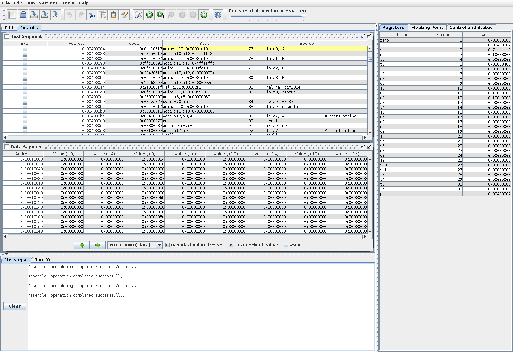

## 五、调试证据

> 以下四张截图都只运行一组：先把 `first_case` 和 `last_case` 改成同一个编号，再 Assemble，然后在 Execute 窗口中勾选断点。

### 5.1 跨字进位（第 6 组，M + 1）

断点：add1024 里 `sw t2, 0(a2)` 这一行（`# write Sum[i]`）。

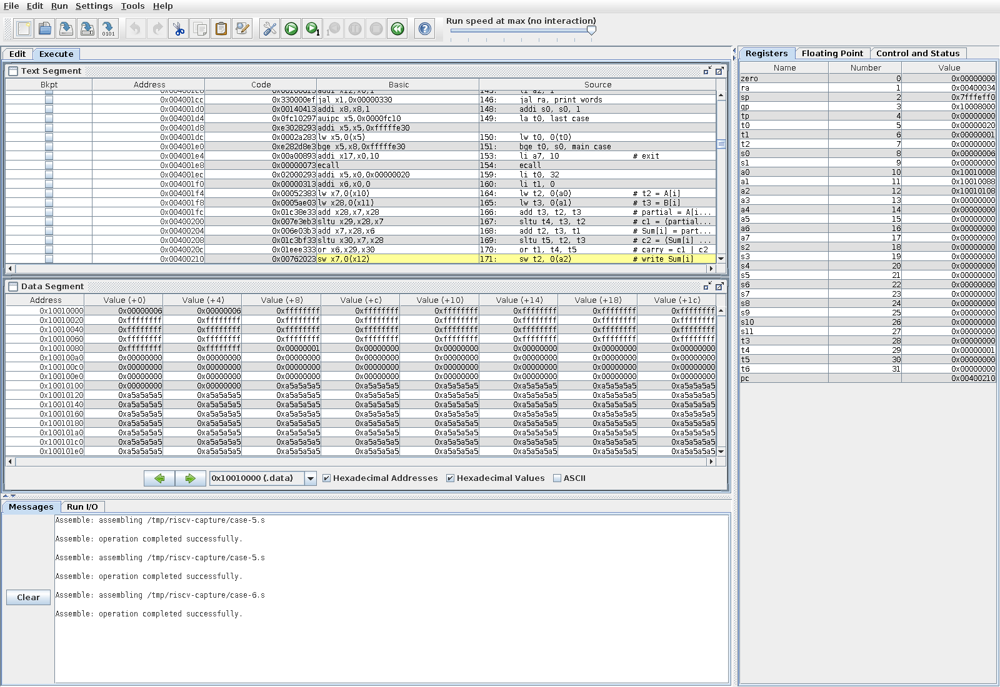

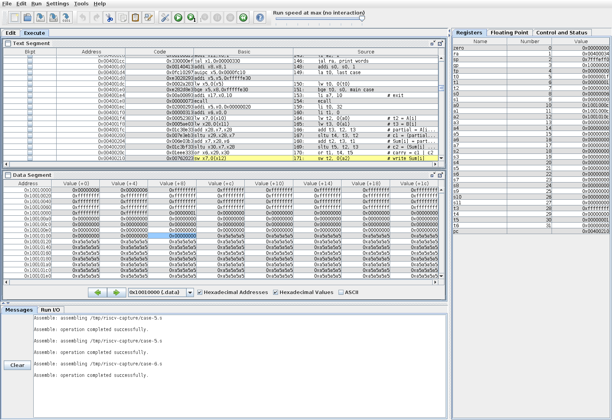

两次停下时的寄存器值：

| | t2（Sum[i]） | t3（partial） | t4（c1） | t5（c2） | t1（carry） |
|---|---|---|---|---|---|
| 第 1 次（i=0） | 0x00000000 | 0x00000000 | 1 | 0 | 1 |
| 第 2 次（i=1） | 0x00000000 | 0xffffffff | 0 | 1 | 1 |

说明：第 0 个字是 `0xffffffff + 1`，第一步就回绕成 0，所以 c1 = 1。第 1 个字是 `0xffffffff + 0`，第一步没有进位；但再加上传上来的 carry = 1 时回绕，所以这次是 c2 = 1。这说明进位确实从低字传到了高字，而且两步的进位都要检查。这个进位一直传到最高字，最后 carry = 1，Sum 全是 0。

### 5.2 跨字借位（第 1 组，0 − 1）

断点：sub1024 里 `sw t2, 0(a2)` 这一行（`# write Sub[i]`）。

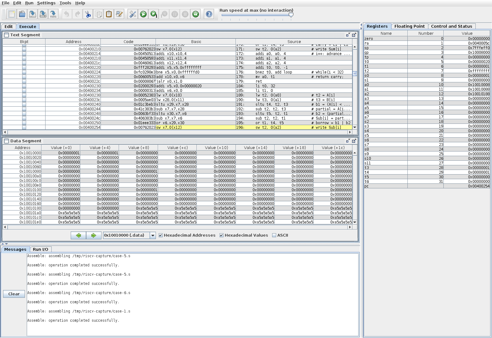

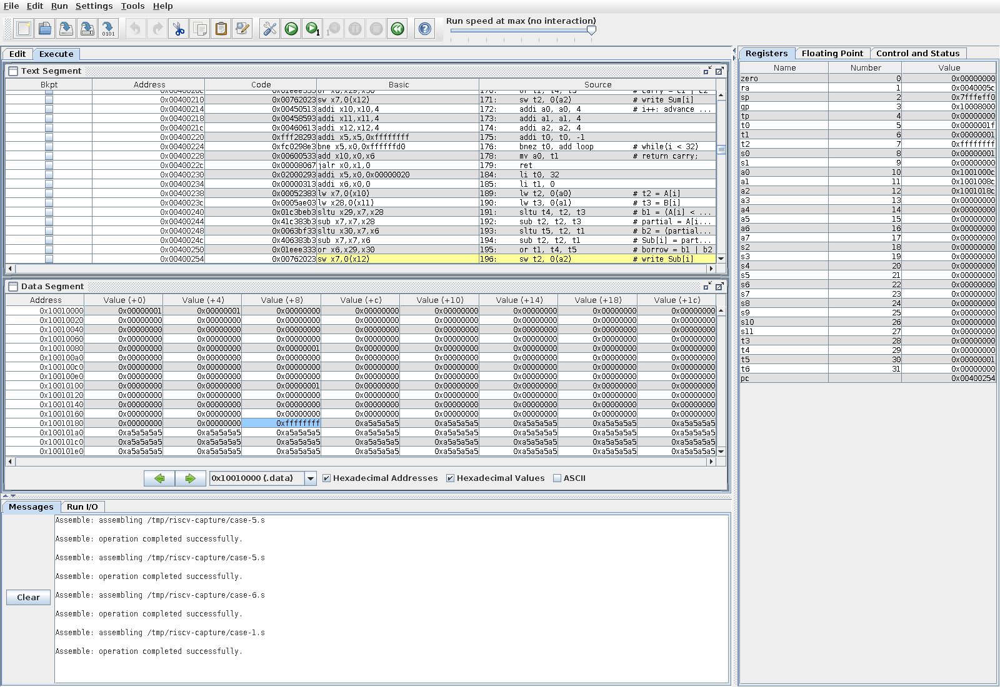

两次停下时的寄存器值：

| | t2（Sub[i]） | t4（b1） | t5（b2） | t1（borrow） |
|---|---|---|---|---|
| 第 1 次（i=0） | 0xffffffff | 1 | 0 | 1 |
| 第 2 次（i=1） | 0xffffffff | 0 | 1 | 1 |

说明：第 0 个字 0 − 1 不够减，b1 = 1，结果回绕成 `0xffffffff`。第 1 个字 0 − 0 本身够减，b1 = 0；但还要减去低字的借位 1，又不够减，所以 b2 = 1。借位就这样一直传到最高字，最后 borrow = 1，Sub 的 32 个字全是 `0xffffffff`，也就是 M。

### 5.3 乘法向高位传播（第 10 组，2^1023 × 3）

断点：mul1024 里 `addi s2, s2, 1` 这一行（`# i++`），它在每轮左移 T 之后执行。

T 在栈上，T[31]、T[32] 分别在 sp+124、sp+128，按 RARS 默认设置是 0x7fffef5c、0x7fffef60；Pro[31]、Pro[32] 在 0x10010284、0x10010288。

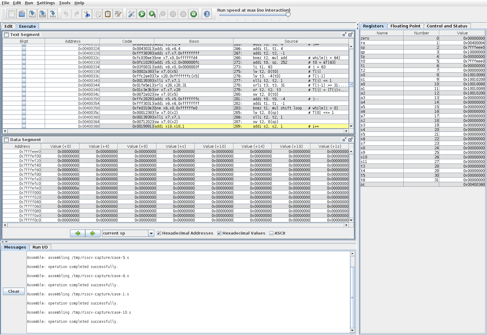

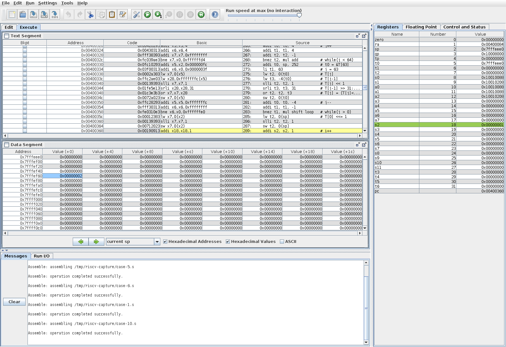

两次停下时的内存值：

| | T[31] | T[32] | Pro[31] | Pro[32] |
|---|---|---|---|---|
| 第 1 次（i=0 结束） | 0x00000000 | 0x00000001 | 0x80000000 | 0x00000000 |
| 第 2 次（i=1 结束） | 0x00000000 | 0x00000002 | 0x80000000 | 0x00000001 |

说明：A = 2^1023，所以 T 一开始只有 T[31] 的最高位是 1。B = 3 的第 0 位是 1，于是先把 T 加到 Pro 上，Pro[31] = 0x80000000。然后 T 左移 1 位，T[31] 的最高位移进了 T[32] 的最低位，T 变成 2^1024，已经超出了前 32 个字。第 1 位也是 1，再加一次 T，Pro[32] = 1。所以最后 Pro = 2^1024 + 2^1023，高位确实写进了 Pro 的后 32 个字。

### 5.4 除法的关键状态（第 5 组，100 ÷ 7）

断点：div1024 里 `jal ra, sub1024` 这一行（`# sub1024(R, B, D);`），只有 R ≥ B 时才会走到这里。

R[0] 在 0x10010388，Q[0] 在 0x10010308。

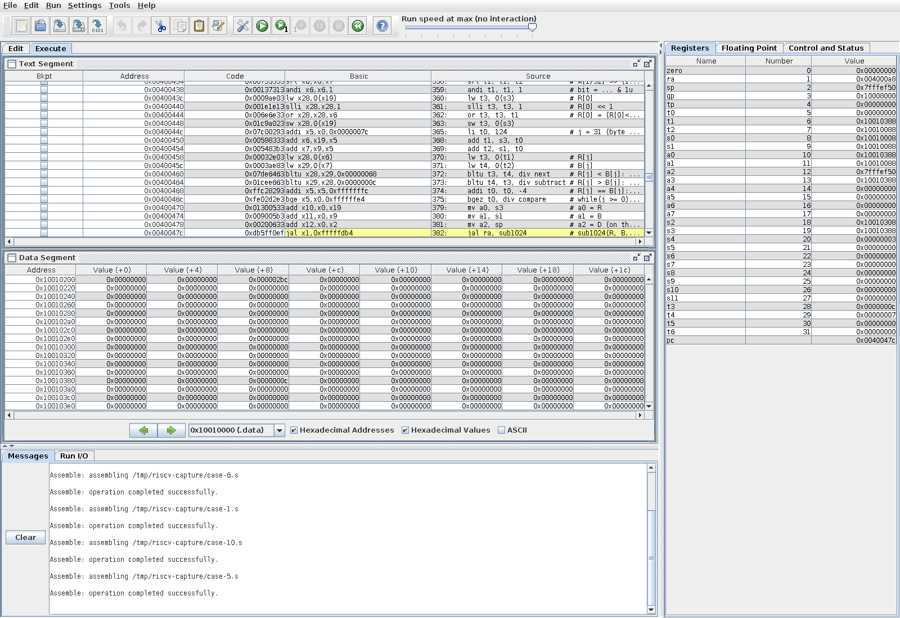

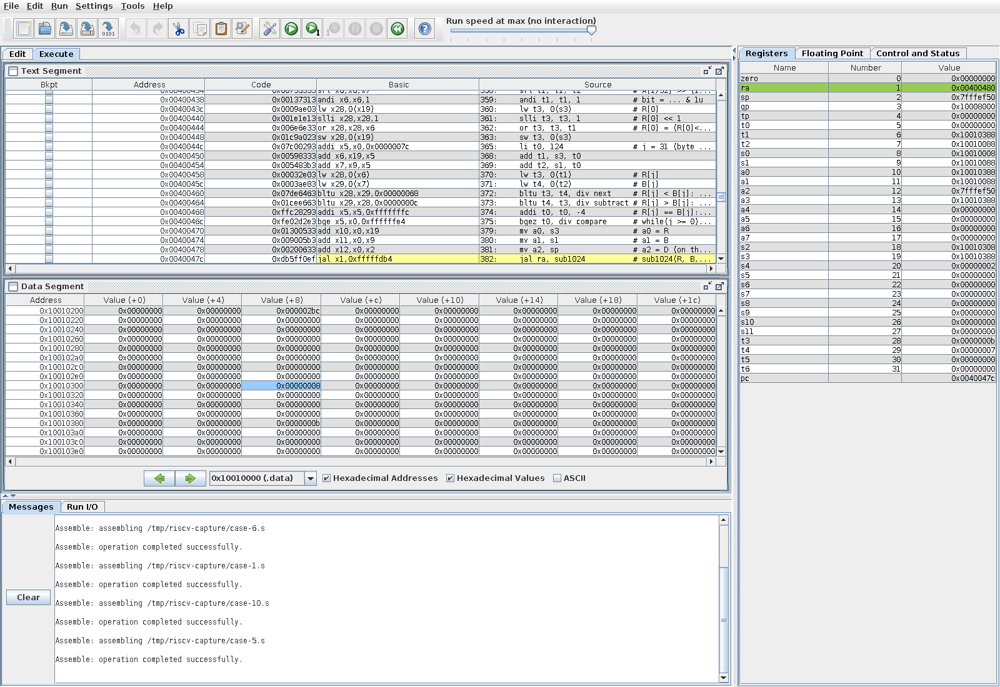


100 的二进制是 `1100100`，第 6、5、2 位是 1。前三次停下时的值：

| | s4（i） | R[0]（减之前） | Q[0] |
|---|---|---|---|
| 第 1 次 | 3 | 0x0000000c（12） | 0x00000000 |
| 第 2 次 | 2 | 0x0000000b（11） | 0x00000008 |
| 第 3 次 | 1 | 0x00000008（8） | 0x0000000c |

说明：i 从 1023 到 7 时，落下来的位都是 0，R 一直是 0。i = 6、5、4 时，R 依次变成 1、3、6，都小于 7，不用减，所以断点不会停。i = 3 时 R = 12 ≥ 7，第一次停下；减完后 R = 5，Q 的第 3 位置 1。下一轮 R = 2 × 5 + 1 = 11，又够减，减完 R = 4，Q 的第 2 位置 1，Q[0] 变成 0x0000000c。以此类推，最后 Q = 14（0xe），R = 2，满足 100 = 7 × 14 + 2，而且每轮减完都有 R < 7。

## 六、总结

### 6.1 遇到的问题和解决办法

1. **加法：不会判断进位。** 一开始我觉得两个非负数相加，结果不会比原来的数小，所以不理解“结果变小就是进位”这个判断。后来通过算例弄懂了回绕：比如 `0xffffffff + 1` 只留下 0。我还发现加上进位这一步也可能回绕，所以两步要分别检查。另外，我曾经先更新 carry 再把它加进本字，旧的进位就被覆盖了；后来调整了先后顺序。
2. **减法：借位方向。** 一开始我按纸上竖式的习惯，想在本位不够减时往高位找可以借的位，再去改中间的位。这样流程很复杂，还会修改输入数组，不符合要求。后来我明白，只需要记一个 borrow，让下一个字多减 1 就行，不用真的去改高位的输入。
3. **乘法：宽度和移位。** 一开始我没有分清输入和乘积的宽度，想直接用只处理 32 个字的 add1024 来累加乘积，结果高 32 个字和跨界的进位都没有处理。后来我把累加扩展到 64 个字。我还曾把数组元素整体挪动一格当作左移一位，其实那是乘以 2^32；正确做法是每个字左移 1 位，再接上低字的最高位。另外，我曾把移位放在了循环外面，T 没有每轮翻倍，后来移回了循环里面。取 B 的第 k 位时，我也曾搞混过移位方向。
4. **除法：比较和移位。** 从高字往低字比较时，我曾在两个字相等时就用 `>=` 提前下结论。其实高字相等时还要继续比下一个字，只有遇到不相等的字才能决定大小。另外，余数要整体左移一位再放入新的位，处理顺序要从高字到低字。
5. **从 C 改写成汇编。** C 里由编译器处理的事情，在汇编里都要自己安排：数组地址要乘 4，数据要用 `.align 2` 对齐，栈帧大小要算清楚，用过的 s 寄存器要保存恢复，除法调用 sub1024 前还要保存 ra。返回前必须先取回寄存器，再把 sp 加回去。

程序能正确运行之后，我又整理了代码：给关键指令加了对应 C 表达式的注释，按步骤用空行分段，删减了重复的段首说明，并把除法的返回值统一命名为 `status`，和任务书的说法一致。

### 6.2 仍存在的不足

1. **乘法和除法都是逐位处理的**，每次调用要执行几十万到一百多万条指令（见 3.5），在 RARS 里一次跑完 10 组要等一会儿。乘法里最费时的是每轮都把 64 个字的 T 整体左移一次（每轮 575 条）；如果改成按位偏移直接把 A 加到 Pro 的对应位置，就能省掉这一步，但代码会复杂很多。
2. **除法每次够减都要先把差写进 D，再复制回 R**，每次多出 226 条复制指令。这是为了遵守“缓冲区不重叠”的约定；如果专门写一个原地相减的函数，就能省掉复制。
3. **main 没有检查用例编号的范围。** 如果 `first_case` 或 `last_case` 填成 1–10 以外的数，`load_case` 会按第 10 组处理，不会报错。
4. **结果只按十六进制打印**，没有转成十进制。任务书不要求十进制输出，但对照大数时要手动换算。
5. **寄存器和栈的恢复是靠断点和寄存器窗口人工检查的**，程序本身没有自动比较调用前后的值。

## 附录：源程序 bigint1024.s

以下为提交的完整源程序，和提交包中的 `bigint1024.s` 相同。

```asm
# Using RARS 1.6 / RV32I


.data
.align 2 # 4-byte alignment.
first_case: .word 1
last_case:  .word 10
# uint32_t A[32], B[32], Sum[32], Sub[32], Pro[64], Q[32], R[32];
A:          .space 128
B:          .space 128
Sum:        .space 128
Sub:        .space 128
Pro:        .space 256
Q:          .space 128
R:          .space 128

# Return values saved by main: add carry, sub borrow, div status.
carry:      .word 0
borrow:     .word 0
status:     .word 0

# Output strings for printing.
case_text:  .asciz "\nCase "
newline:    .asciz "\n"
space:      .asciz " "
a_text:     .asciz "A: "
b_text:     .asciz "B: "
sum_text:   .asciz "Sum: "
sub_text:   .asciz "Sub: "
pro_text:   .asciz "Pro: "
q_text:     .asciz "Q: "
r_text:     .asciz "R: "
carry_text: .asciz "carry: "
borrow_text: .asciz "borrow: "
status_text: .asciz "status: "

.text
.globl main
.globl add1024
.globl sub1024
.globl mul1024
.globl div1024


# main: run cases first_case..last_case; s0 = current case (kept across calls).
main:
    # Align the initial RARS stack pointer to 16 bytes.
    andi sp, sp, -16
    la t0, first_case
    lw s0, 0(t0)
main_case:
    mv a0, s0
    jal ra, load_case

    la a0, A
    la a1, B
    la a2, Sum
    # carry = add1024(A, B, Sum);
    jal ra, add1024
    la t0, carry
    sw a0, 0(t0)

    la a0, A
    la a1, B
    la a2, Sub
    # borrow = sub1024(A, B, Sub);
    jal ra, sub1024
    la t0, borrow
    sw a0, 0(t0)

    la a0, A
    la a1, B
    la a2, Pro
    # mul1024(A, B, Pro); always returns 0, so a0 is not saved.
    jal ra, mul1024

    la a0, A
    la a1, B
    la a2, Q
    la a3, R
    # status = div1024(A, B, Q, R);
    jal ra, div1024
    la t0, status
    sw a0, 0(t0)

    # printf("\nCase %d\n", test);
    # only print and main use ecall
    la a0, case_text
    li a7, 4                  # print string
    ecall
    mv a0, s0
    li a7, 1                  # print integer
    ecall
    la a0, newline
    li a7, 4                  # print string
    ecall
    # print_words(name, &X, word count) for every input and result.
    la a0, a_text
    la a1, A
    li a2, 32
    jal ra, print_words

    la a0, b_text
    la a1, B
    li a2, 32
    jal ra, print_words

    la a0, sum_text
    la a1, Sum
    li a2, 32
    jal ra, print_words

    la a0, sub_text
    la a1, Sub
    li a2, 32
    jal ra, print_words

    la a0, pro_text
    la a1, Pro
    li a2, 64
    jal ra, print_words

    la a0, q_text
    la a1, Q
    li a2, 32
    jal ra, print_words

    la a0, r_text
    la a1, R
    li a2, 32
    jal ra, print_words

    la a0, carry_text
    la a1, carry
    li a2, 1
    jal ra, print_words

    la a0, borrow_text
    la a1, borrow
    li a2, 1
    jal ra, print_words

    la a0, status_text
    la a1, status
    li a2, 1
    jal ra, print_words

    addi s0, s0, 1
    la t0, last_case
    lw t0, 0(t0)
    bge t0, s0, main_case

    li a7, 10                 # exit
    ecall

# add1024: a0=&A, a1=&B, a2=&Sum; returns carry in a0. Leaf, no stack frame.
# t0 = words left, t1 = carry.
add1024:
    li t0, 32
    li t1, 0

# for(int i=0; i<32; i++)
add_loop:
    lw t2, 0(a0)              # t2 = A[i]
    lw t3, 0(a1)              # t3 = B[i]
    add t3, t2, t3            # partial = A[i] + B[i]
    sltu t4, t3, t2           # c1 = (partial < A[i])
    add t2, t3, t1            # Sum[i] = partial + carry
    sltu t5, t2, t3           # c2 = (Sum[i] < partial)
    or t1, t4, t5             # carry = c1 | c2
    sw t2, 0(a2)              # write Sum[i]
    addi a0, a0, 4            # i++: advance &A[i], &B[i], &Sum[i]
    addi a1, a1, 4
    addi a2, a2, 4
    addi t0, t0, -1
    bnez t0, add_loop         # while(i < 32)

    mv a0, t1                 # return carry;
    ret

# sub1024: a0=&A, a1=&B, a2=&Sub; returns borrow in a0. Leaf, no stack frame.
# t0 = words left, t1 = borrow.
sub1024:
    li t0, 32
    li t1, 0

# for(int i=0; i<32; i++)
sub_loop:
    lw t2, 0(a0)              # t2 = A[i]
    lw t3, 0(a1)              # t3 = B[i]
    sltu t4, t2, t3           # b1 = (A[i] < B[i])
    sub t2, t2, t3            # partial = A[i] - B[i]
    sltu t5, t2, t1           # b2 = (partial < borrow)
    sub t2, t2, t1            # Sub[i] = partial - borrow
    or t1, t4, t5             # borrow = b1 | b2
    sw t2, 0(a2)              # write Sub[i]
    addi a0, a0, 4            # i++: advance &A[i], &B[i], &Sub[i]
    addi a1, a1, 4
    addi a2, a2, 4
    addi t0, t0, -1
    bnez t0, sub_loop         # while(i < 32)

    mv a0, t1                 # return borrow;
    ret

# mul1024: a0=&A, a1=&B, a2=&Pro; returns 0. Leaf.
# s0 = &B, s1 = &Pro, s2 = i (bit index of B).
# Frame 272 bytes: T[64] at sp+0..255, s0-s2 at sp+256..264.
mul1024:
    addi sp, sp, -272
    sw s0, 256(sp)
    sw s1, 260(sp)
    sw s2, 264(sp)

    mv s0, a1                 # s0 = B
    mv s1, a2                 # s1 = Pro
    li s2, 0                  # i = 0 (bit index of B)
    li t0, 0                  # j = 0
    mv t1, sp                 # t1 = &T[0]
    mv t2, a2                 # t2 = &Pro[0]

# for(int j=0; j<64; j++)
mul_init:
    sw zero, 0(t2)            # Pro[j] = 0
    li t3, 32
    bge t0, t3, mul_init_high # if(j >= 32) T[j] = 0
    lw t4, 0(a0)              # else T[j] = A[j]
    addi a0, a0, 4
    j mul_init_store
mul_init_high:
    li t4, 0
mul_init_store:
    sw t4, 0(t1)              # write T[j]
    addi t1, t1, 4
    addi t2, t2, 4
    addi t0, t0, 1            # j++
    li t3, 64
    blt t0, t3, mul_init      # while(j < 64)

# for(int i=0; i<1024; i++)
mul_bit:
    srli t0, s2, 5            # i / 32
    slli t0, t0, 2            # byte offset 4*(i/32)
    add t0, s0, t0            # &B[i/32]
    lw t1, 0(t0)              # B[i/32]
    andi t2, s2, 31           # i % 32
    srl t1, t1, t2            # B[i/32] >> (i%32)
    andi t1, t1, 1            # bit_i = ... & 1u
    beqz t1, mul_shift        # if(!bit_i) skip addition;

    mv t0, s1                 # t0 = &Pro[0]
    mv t1, sp                 # t1 = &T[0]
    li t2, 64                 # 64 words to add
    li t3, 0                  # carry = 0
# if(bit_i) Pro += T over 64 words; t3 = carry.
mul_add:
    lw t4, 0(t0)              # t4 = Pro[j]
    lw t5, 0(t1)              # t5 = T[j]
    add t6, t4, t5            # partial = Pro[j] + T[j]
    sltu a3, t6, t4           # c1 = (partial < Pro[j])
    add t4, t6, t3            # Pro[j] = partial + carry
    sltu a4, t4, t6           # c2 = (Pro[j] < partial)
    or t3, a3, a4             # carry = c1 | c2
    sw t4, 0(t0)              # write Pro[j]
    addi t0, t0, 4            # j++
    addi t1, t1, 4
    addi t2, t2, -1
    bnez t2, mul_add          # while(j < 64)

# T <<= 1 over 64 words, high word first: for(int j=63; j>0; j--)
mul_shift:
    addi t0, sp, 252          # t0 = &T[63]
    li t1, 63                 # j = 63
mul_shift_loop:
    lw t2, 0(t0)              # T[j]
    lw t3, -4(t0)             # T[j-1]
    slli t2, t2, 1            # T[j] << 1
    srli t3, t3, 31           # T[j-1] >> 31: bit moving up
    or t2, t2, t3             # T[j] = (T[j]<<1) | (T[j-1]>>31)
    sw t2, 0(t0)
    addi t0, t0, -4           # j--
    addi t1, t1, -1
    bnez t1, mul_shift_loop   # while(j > 0)

    lw t2, 0(sp)              # T[0] <<= 1
    slli t2, t2, 1
    sw t2, 0(sp)

    addi s2, s2, 1            # i++
    li t0, 1024
    blt s2, t0, mul_bit       # while(i < 1024)

    # Restore s0-s2 and release the frame.
    lw s0, 256(sp)
    lw s1, 260(sp)
    lw s2, 264(sp)
    addi sp, sp, 272
    li a0, 0                  # return 0;
    ret

# div1024: a0=&A, a1=&B, a2=&Q, a3=&R; returns 0, or 1 if B==0 (Q=R=0).
# s0 = &A, s1 = &B, s2 = &Q, s3 = &R, s4 = i (bit index of A).
# Frame 160 bytes: D[32] at sp+0..127, s0-s4 at sp+128..144, ra at sp+148.
# Invariant: R < B and R <= processed prefix of A, so 2R+bit fits in 32 words.
div1024:
    addi sp, sp, -160
    sw s0, 128(sp)
    sw s1, 132(sp)
    sw s2, 136(sp)
    sw s3, 140(sp)
    sw s4, 144(sp)
    sw ra, 148(sp)

    mv s0, a0                 # s0 = A
    mv s1, a1                 # s1 = B
    mv s2, a2                 # s2 = Q
    mv s3, a3                 # s3 = R
    li t0, 0                  # j = 0 (as byte offset 4*j)
    li t1, 0                  # divisor_bits = 0
    li t2, 32

# for(int j=0; j<32; j++)
div_clear:
    add t3, s2, t0
    sw zero, 0(t3)            # Q[j] = 0
    add t3, s3, t0
    sw zero, 0(t3)            # R[j] = 0
    add t3, s1, t0
    lw t4, 0(t3)              # B[j]
    or t1, t1, t4             # divisor_bits |= B[j]
    addi t0, t0, 4            # j++
    addi t2, t2, -1
    bnez t2, div_clear        # while(j < 32)

    beqz t1, div_zero         # if(divisor_bits == 0) return 1;
    li s4, 1023               # i = 1023

# for(int i=1023; i>=0; i--): R = 2R + bit i of A
div_bit:
    addi t0, s3, 124          # t0 = &R[31]
    li t1, 31                 # j = 31
div_shift:
    lw t2, 0(t0)              # R[j]
    lw t3, -4(t0)             # R[j-1]
    slli t2, t2, 1            # R[j] << 1
    srli t3, t3, 31           # R[j-1] >> 31: bit moving up
    or t2, t2, t3             # R[j] = (R[j]<<1) | (R[j-1]>>31)
    sw t2, 0(t0)
    addi t0, t0, -4           # j--
    addi t1, t1, -1
    bnez t1, div_shift        # while(j > 0)

    srli t0, s4, 5            # i / 32
    slli t0, t0, 2            # byte offset 4*(i/32)
    add t0, s0, t0            # &A[i/32]
    lw t1, 0(t0)              # A[i/32]
    andi t2, s4, 31           # i % 32
    srl t1, t1, t2            # A[i/32] >> (i%32)
    andi t1, t1, 1            # bit = ... & 1u
    lw t3, 0(s3)              # R[0]
    slli t3, t3, 1            # R[0] << 1
    or t3, t3, t1             # R[0] = (R[0]<<1) | bit
    sw t3, 0(s3)

    li t0, 124                # j = 31 (byte offset 124)
# if(R >= B): compare from the highest word down; t0 = 4*j
div_compare:
    add t1, s3, t0
    add t2, s1, t0
    lw t3, 0(t1)              # R[j]
    lw t4, 0(t2)              # B[j]
    bltu t3, t4, div_next     # R[j] < B[j]: R < B, no subtraction
    bltu t4, t3, div_subtract # R[j] > B[j]: R > B, subtract
    addi t0, t0, -4           # R[j] == B[j]: j--, compare lower word
    bgez t0, div_compare      # while(j >= 0); falling out means R == B

# R -= B into temporary D (sub1024 buffers must not overlap)
div_subtract:
    mv a0, s3                 # a0 = R
    mv a1, s1                 # a1 = B
    mv a2, sp                 # a2 = D (on the stack)
    jal ra, sub1024           # sub1024(R, B, D);

    li t0, 0                  # j = 0 (as byte offset 4*j)
    li t1, 32
# for(int j=0; j<32; j++)
div_copy:
    add t2, sp, t0
    lw t3, 0(t2)              # D[j]
    add t2, s3, t0
    sw t3, 0(t2)              # R[j] = D[j]
    addi t0, t0, 4            # j++
    addi t1, t1, -1
    bnez t1, div_copy         # while(j < 32)

    srli t0, s4, 5            # i / 32
    slli t0, t0, 2            # byte offset 4*(i/32)
    add t0, s2, t0            # &Q[i/32]
    andi t1, s4, 31           # i % 32
    li t2, 1
    sll t2, t2, t1            # 1u << (i%32)
    lw t3, 0(t0)              # Q[i/32]
    or t3, t3, t2             # Q[i/32] |= 1u << (i%32)
    sw t3, 0(t0)

div_next:
    addi s4, s4, -1           # i--
    bgez s4, div_bit          # while(i >= 0)

    li a0, 0                  # return 0;
    j div_return

# B == 0: Q and R are already cleared.
div_zero:
    li a0, 1                  # return 1;

# Restore s0-s4, ra and release the frame.
div_return:
    lw s0, 128(sp)
    lw s1, 132(sp)
    lw s2, 136(sp)
    lw s3, 140(sp)
    lw s4, 144(sp)
    lw ra, 148(sp)
    addi sp, sp, 160
    ret

# print_words: a0=name, a1=&X, a2=word count; prints X high word first.
# Uses ecall, so it is kept out of the arithmetic routines.
print_words:
    li a7, 4                  # print string
    ecall

    slli t0, a2, 2
    add t0, a1, t0
    addi t0, t0, -4
    mv t1, a2
# for(int i=count-1; i>=0; i--); t0 = &X[i], t1 = words left
print_loop:
    lw a0, 0(t0)
    li a7, 34                 # print word in hex
    ecall
    la a0, space
    li a7, 4                  # print string
    ecall
    addi t0, t0, -4
    addi t1, t1, -1
    bnez t1, print_loop

    la a0, newline
    li a7, 4                  # print string
    ecall
    ret

# load_case(int test): a0=test (1..10); initialize global inputs and outputs.
load_case:
    la t0, A
    la t1, B
    li t2, 32
# for(int i=0; i<32; i++) A[i]=B[i]=0;
case_clear:
    sw zero, 0(t0)
    sw zero, 0(t1)
    addi t0, t0, 4
    addi t1, t1, 4
    addi t2, t2, -1
    bnez t2, case_clear

    la t0, Sum
    la t1, carry
    li t2, 0xa5a5a5a5
# Fill Sum..R with 0xa5a5a5a5 to expose unwritten words; R ends at carry.
case_fill_outputs:
    sw t2, 0(t0)
    addi t0, t0, 4
    bltu t0, t1, case_fill_outputs

    la t0, A
    la t1, B
    # switch(test): branch to cases 1..9; valid case 10 falls through.
    li t2, 1
    beq a0, t2, case_1
    li t2, 2
    beq a0, t2, case_2
    li t2, 3
    beq a0, t2, case_3
    li t2, 4
    beq a0, t2, case_4
    li t2, 5
    beq a0, t2, case_5
    li t2, 6
    beq a0, t2, case_6
    li t2, 7
    beq a0, t2, case_7
    li t2, 8
    beq a0, t2, case_8
    li t2, 9
    beq a0, t2, case_9
    # case 10: A[31]=1u<<31; B[0]=3; // A=2^1023.
    li t2, 0x80000000
    sw t2, 124(t0)
    li t2, 3
    sw t2, 0(t1)
    ret
# case 1: A=0, B=1.
case_1:
    li t2, 1
    sw t2, 0(t1)
    ret
# case 2: A=1, B=0.
case_2:
    li t2, 1
    sw t2, 0(t0)
    ret
# case 3: A=B=2^700+123456789. 700=21*32+28, so word 21 is at byte offset 84.
case_3:
    li t2, 123456789
    sw t2, 0(t0)
    sw t2, 0(t1)
    li t2, 0x10000000
    sw t2, 84(t0)
    sw t2, 84(t1)
    ret
# case 4: A=100, B=4.
case_4:
    li t2, 100
    sw t2, 0(t0)
    li t2, 4
    sw t2, 0(t1)
    ret
# case 5: A=100, B=7.
case_5:
    li t2, 100
    sw t2, 0(t0)
    li t2, 7
    sw t2, 0(t1)
    ret
# case 6: B[0]=1; for(int i=0; i<32; i++) A[i]=UINT32_MAX;
case_6:
    li t2, 1
    sw t2, 0(t1)
    li t2, -1
    li t3, 32
case_6_loop:
    sw t2, 0(t0)
    addi t0, t0, 4
    addi t3, t3, -1
    bnez t3, case_6_loop
    ret
# case 7: A[31]=1; B[0]=1; // A=2^992.
case_7:
    li t2, 1
    sw t2, 124(t0)
    sw t2, 0(t1)
    ret
# case 8: for(int i=0; i<32; i++) A[i]=B[i]=UINT32_MAX;
case_8:
    li t2, -1
    li t3, 32
case_8_loop:
    sw t2, 0(t0)
    sw t2, 0(t1)
    addi t0, t0, 4
    addi t1, t1, 4
    addi t3, t3, -1
    bnez t3, case_8_loop
    ret
# case 9: A=5, B=9.
case_9:
    li t2, 5
    sw t2, 0(t0)
    li t2, 9
    sw t2, 0(t1)
    ret

```
