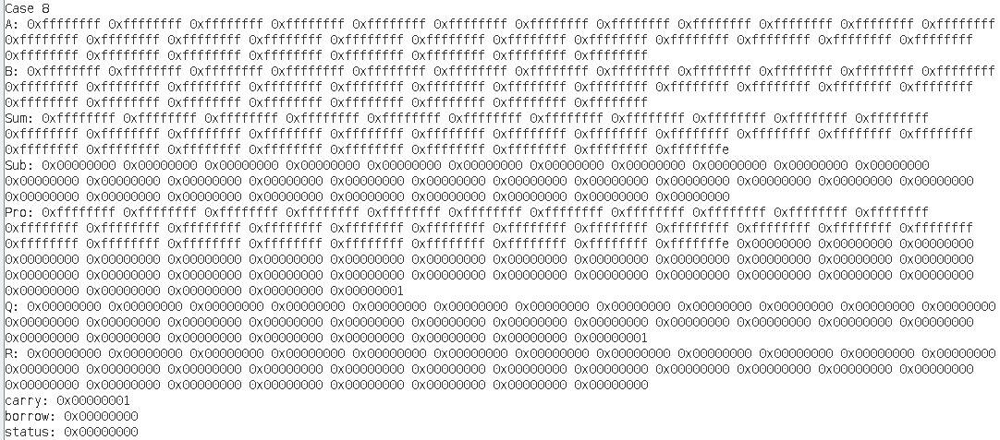
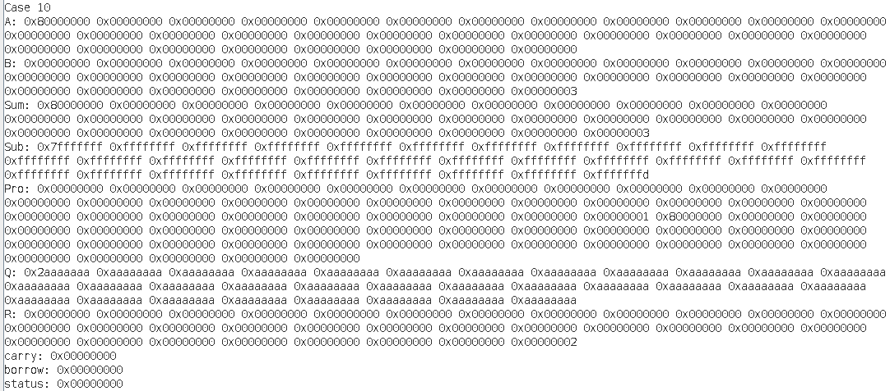
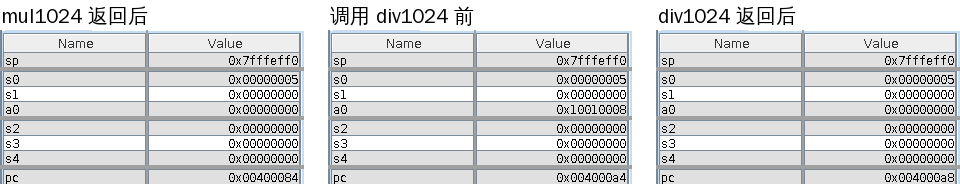
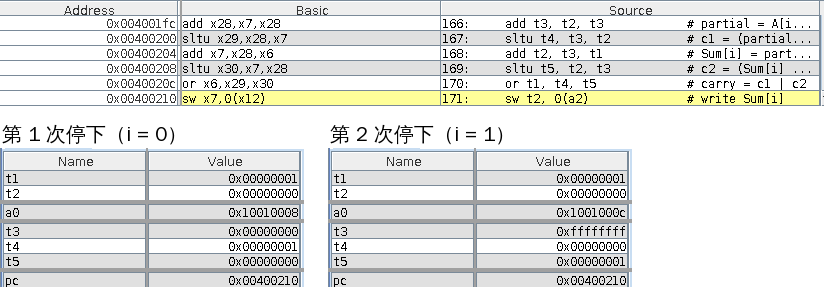
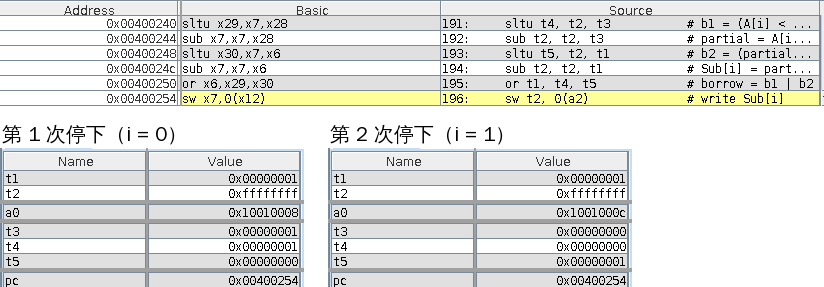
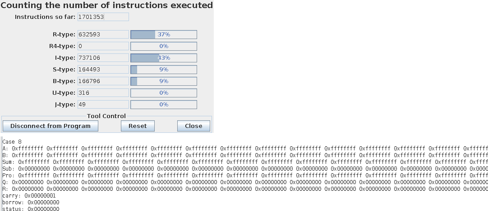

# 实验报告：基于 RISC-V 的 1024 位无符号整数运算

## 一、基本信息

| 项目 | 内容 |
|---|---|
| 学号 | 3250105856 |
| 姓名 | 郑逸枫 |
| 实验名称 | 基于 RISC-V 的 1024 位无符号整数运算 |
| RARS 版本与模式 | RARS 1.6，RV32 模式，允许伪指令 |
| 运行环境 | Windows + WSL2 Ubuntu 24.04，Java: OpenJDK 21.0.12.1（64 位）|
| 提交文件 | `bigint1024.s`（源程序），`实验报告.pdf`（本报告） |

## 二、数据与寄存器设计

### 2.1 数据布局

RV32 的一个字是 32 位，即 4 个字节。一个 1024 位的数要用 32 个字来存，占 128 字节。按“低位字在前”的顺序存放：A[0] 是最低的 32 位，A[31] 是最高的 32 位，所以

`A = A[0] + A[1]×2^32 + A[2]×2^64 + … + A[31]×2^992`

第 i 个字的地址是“首地址 + 4×i”。乘积 Pro 是 2048 位，要用 64 个字，占 256 字节。

所有缓冲区都在 `.data` 段里，用 `.align 2` 按 4 字节对齐。RARS 默认把数据段放在 `0x10010000`，所以各标签的地址如下，在 Data Segment 窗口按这些地址就能找到结果。

| 标签 | 地址 | 大小 | 内容 |
|---|---|---|---|
| `first_case` | 0x10010000 | 1 字 | 第一个要运行的用例编号，默认 1 |
| `last_case` | 0x10010004 | 1 字 | 最后一个要运行的用例编号，默认 10 |
| `A` | 0x10010008 | 32 字 | 被加数、被减数、被乘数、被除数 |
| `B` | 0x10010088 | 32 字 | 加数、减数、乘数、除数 |
| `Sum` | 0x10010108 | 32 字 | 和 S |
| `Sub` | 0x10010188 | 32 字 | 差 D |
| `Pro` | 0x10010208 | 64 字 | 完整 2048 位乘积 P |
| `Q` | 0x10010308 | 32 字 | 商 |
| `R` | 0x10010388 | 32 字 | 余数 |
| `carry` | 0x10010408 | 1 字 | add1024 的返回值，1 表示加法溢出 |
| `borrow` | 0x1001040c | 1 字 | sub1024 的返回值，1 表示 A < B |
| `status` | 0x10010410 | 1 字 | div1024 的返回值，1 表示除数为 0 |

`mul1024` 按要求在 a0 中返回 0，因为返回值恒为 0，main 没有单独保存它（见图 4）。

**切换用例：** 把 `first_case` 和 `last_case` 改成 1 到 10 中的同一个数，就只运行这一组；默认是 1 到 10 全部运行。10 组输入写在 `load_case` 子程序里。每组开始前，`load_case` 还会把 Sum、Sub、Pro、Q、R 全部填成 `0xa5a5a5a5`，用来检查有没有漏写的输出字。

### 2.2 寄存器用途

按任务书的调用约定，a0–a7 和 t0–t6 可以随便改；s0–s11 如果用了，返回前必须恢复成原来的值。

**main**

| 寄存器 | 用途 |
|---|---|
| s0 | 当前用例编号，跨所有函数调用保持不变 |
| a0–a3 | 给运算函数传参数；调用后 a0 是返回值，main 马上把它存到 carry、borrow 或 status |
| a7 | ecall 的服务号：4 打印字符串，1 打印整数，34 按十六进制打印一个字，10 退出 |
| t0 | 临时存放标签地址 |

**add1024 / sub1024**

由于两个函数结构一样，这里合并处理。

| 寄存器 | 用途 |
|---|---|
| a0, a1, a2 | 入口时是 &A、&B、&Sum（或 &Sub），每处理一个字就加 4，指向下一个字 |
| t0 | 还剩几个字没处理，从 32 减到 0 |
| t1 | 进位 carry（减法里是借位 borrow），最后放进 a0 返回 |
| t2, t3 | A[i]、B[i] 和中间结果 |
| t4, t5 | 两步运算各自有没有产生进位（借位） |

**mul1024**

| 寄存器 | 用途 |
|---|---|
| s0 | &B |
| s1 | &Pro |
| s2 | i，正在看 B 的第几位（0–1023） |
| t0–t2 | 循环下标 j 和数组指针 |
| t3 | 64 字累加时的进位 |
| t4–t6, a3, a4 | 累加和移位时的中间值；a3、a4 是两步进位标志 |

**div1024**

| 寄存器 | 用途 |
|---|---|
| s0, s1, s2, s3 | &A、&B、&Q、&R |
| s4 | i，正在处理 A 的第几位（从 1023 往下数到 0） |
| ra | 调用 sub1024 前已保存，返回前恢复 |
| a0–a2 | 调用 sub1024 时传参数 |
| t0–t4 | 下标、地址和中间值 |

### 2.3 栈帧与保存恢复

栈帧是函数进入时在栈上临时划出来的一块空间，用来放局部数组和要保存的寄存器，返回前再还回去。每个栈帧的大小都是 16 的倍数，保证 sp 16 字节对齐。

- **main**：开头用 `andi sp, sp, -16` 把 sp 对齐到 16 字节。main 最后用 ecall 10 退出，不返回。
- **add1024、sub1024**：叶子函数（leaf function），也就是不再调用别的函数的函数。它们只用 a 寄存器和 t 寄存器，所以不需要栈帧。
- **mul1024**：栈帧 272 字节（= 17 × 16）。

  | 位置 | 内容 |
  |---|---|
  | sp+0 ～ sp+255 | 工作数组 T[64]，存左移中的被乘数 |
  | sp+256, +260, +264 | 保存的 s0, s1, s2 |
  | sp+268 | 空着，用来凑满 16 的倍数 |

- **div1024**：栈帧 160 字节（= 10 × 16）。

  | 位置 | 内容 |
  |---|---|
  | sp+0 ～ sp+127 | 临时数组 D[32]，存 R − B 的结果 |
  | sp+128 ～ sp+144 | 保存的 s0–s4 |
  | sp+148 | 保存的 ra（因为要调用 sub1024） |
  | sp+152 ～ sp+159 | 空着，用来凑满 16 的倍数 |

ecall 只在 main 和打印函数 `print_words` 里使用，四个算术函数里都没有用。

## 三、算法说明

我先用 C 写了一遍四个函数（`bigint1024.c`），确认算法和结果都对，再一段一段翻译成汇编。下面每种运算都有对应 C 代码。算法正确性和执行次数的分析放在总结部分。

### 3.1 加法 add1024

加法的关键在于回绕：寄存器只有 32 位，加法结果超过 32 位时，超出的那一位会直接丢掉。所以相加后的结果如果比原来的加数小，就说明产生了进位。

**流程：**

1. carry = 0，从 i = 0（最低字）开始。
2. `partial = A[i] + B[i]`。如果 `partial < A[i]`，说明第一步回绕，记 c1 = 1。
3. `Sum[i] = partial + carry`。如果 `Sum[i] < partial`，说明第二步回绕，记 c2 = 1。
4. `carry = c1 | c2`，把 Sum[i] 写回，carry 留给下一个字。
5. i 加 1，重复第 2–4 步，一共 32 次。
6. 返回 carry：1 表示 A + B ≥ 2^1024，这时 Sum 里存的是和的低 1024 位。

**C 代码：**

```c
uint32_t add1024(const uint32_t* A,const uint32_t* B,uint32_t* Sum){
    uint32_t carry = 0;
    for(int i = 0;i<32;i++){
        Sum[i] = A[i] + B[i];
        if(Sum[i] < A[i]){ // wrap around
            Sum[i] = Sum[i] + carry;
            carry = 1;
        }else{
            Sum[i] = Sum[i] + carry;
            if(Sum[i] < carry){// wrap around
                carry = 1;
            }else{
                carry = 0;
            }
        }
    }
    return carry;
}
```

### 3.2 减法 sub1024

减法也会回绕：`0 − 1` 在 32 位里变成 `0xffffffff`，相当于本字先向高位借了 2^32 再减。所以不用真的去改高位的数，只要记下一个借位 borrow，下一个字多减 1 就行。

**流程：**

1. borrow = 0，从 i = 0（最低字）开始。
2. `b1 = (A[i] < B[i])`：A[i] 不够减，要借位。然后算 `partial = A[i] − B[i]`。
3. `b2 = (partial < borrow)`：再减去低一字的借位时不够减。然后算 `Sub[i] = partial − borrow`。
4. `borrow = b1 | b2`，把 Sub[i] 写回，borrow 留给下一个字。
5. i 加 1，重复第 2–4 步，一共 32 次。
6. 返回 borrow：1 表示 A < B，这时 Sub 里是 (A − B) mod 2^1024。

**C 代码：**

```c
uint32_t sub1024(const uint32_t* A, const uint32_t*B, uint32_t* Sub){
    uint32_t borrow = 0;
    for(int i = 0;i<32;i++){
        Sub[i] = A[i] - B[i];
        if(A[i] < B[i]){ // wrap around automatically, need borrow
            Sub[i] = Sub[i] - borrow;
            borrow = 1;
        }else{
            if(Sub[i] < borrow){ // wrap around automatically,need borrow
                Sub[i] = Sub[i] - borrow;
                borrow = 1;
            }else{
                Sub[i] = Sub[i] - borrow;
                borrow = 0;
            }
        }
    }
    return borrow;
}
```

### 3.3 乘法 mul1024：移位累加

思路和手算的竖式乘法一样，只是换成二进制：B 的第 i 位如果是 1，就把“A 左移 i 位”加到结果上，如果是0 就不加。我用一个 64 字的数组 T 存当前左移过的 A，每看完 B 的一位，T 就整体左移 1 位，等效于数字乘以 2 。所以看到第 i 位时，T 正好等于 A × 2^i。

**流程：**

1. 初始化：Pro 的 64 个字全部清零；T[0..31] = A，T[32..63] = 0。
2. 对 i = 0, 1, …, 1023：
   1. 取出 B 的第 i 位：`(B[i/32] >> (i%32)) & 1`。
   2. 如果这一位是 1，就把 T 加到 Pro 上，64 个字逐字相加，进位方法和 add1024 相同。
   3. 把 T 整体左移 1 位：从 j = 63 到 1，`T[j] = (T[j] << 1) | (T[j−1] >> 31)`，最后 `T[0] <<= 1`。
3. 返回 0。

**C 代码：**

```c
uint32_t mul1024(const uint32_t* A,const uint32_t* B, uint32_t* Pro){
    uint32_t T[64];
    // Initialize the temporary multiplicand.
    for(int i = 0;i<64;i++){
        Pro[i] = 0;
        if(i < 32)T[i] = A[i];
        else T[i] = 0;
    }
    for(int i = 0;i<1024;i++){
        // Extract the current bit.
        uint32_t bit_i = (B[i / 32] >> (i % 32)) & 1;
        if(bit_i){//Add if the bit is 1.
            uint32_t carry = 0;
            for(int j = 0;j<64;j++){
                Pro[j] += T[j];
                if(Pro[j] < T[j]){
                    Pro[j] = Pro[j] + carry;
                    carry = 1;
                }else{
                    Pro[j] += carry;
                    if(Pro[j] < carry){
                        carry = 1;
                    }else{
                        carry = 0;
                    }
                }
            }
        }
        //Shift the entire T left by 1 regardless of the bit, equivalent to multiplying by 2.
        for(int j = 63;j>0;j--){
            T[j] = (T[j] << 1) | (T[j-1] >> 31);
        }
        T[0] <<= 1;
    }
    return 0;
}
```

### 3.4 除法 div1024：按位长除法

思路和手算的竖式除法一样：从被除数的最高位开始，一位一位“落下来”接在余数后面；试减：余数够减除数，商的这一位就是 1，并减掉除数；不够减，商的这一位就是 0。

**流程：**

1. 把 Q 和 R 的 32 个字全部清零，同时检查 B 是否为 0。B = 0 时直接返回 1。
2. 对 i = 1023, 1022, …, 0（从最高位到最低位）：
   1. R 整体左移 1 位，再把 A 的第 i 位放进 R[0] 的最低位，即 `R = 2R + A 的第 i 位`。
   2. 比较 R 和 B：从最高字往下比，遇到第一个不相等的字就能决定大小；全部相等说明 R = B，也算够减。
   3. 如果 R ≥ B：调用 `sub1024(R, B, D)` 把差放进栈上的临时数组 D，再把 D 复制回 R，并把商的第 i 位置 1：`Q[i/32] |= 1 << (i%32)`。
3. 返回 0。

**C 代码：**

```c
uint32_t div1024(const uint32_t* A,const uint32_t* B, uint32_t* Q, uint32_t* R){
    // Use a temporary array to store the subtraction result.
    uint32_t D[32];
    // Use zero to check whether the divisor is zero.
    int zero = 1;
    //Initialize the quotient and remainder.
    for(int i = 0;i<32;i++){
        Q[i] = 0;
        R[i] = 0;
        if(B[i] != 0){
            zero = 0;
        }
    }
    if(zero){
        return 1;
    }

    for(int i = 1023;i>=0;i--){
        //Shift R left by 1 and insert the current dividend bit at the low end.
        for(int j = 31;j>0;j--){
            R[j] = (R[j] << 1) | (R[j-1] >> 31);
        }
        R[0] = (R[0] << 1) | ((A[i/32] >> (i%32)) & 1);

        //Check whether R is large enough to subtract B.
        int greater_equal = 1;
        for(int j = 31;j>=0;j--){
            if(R[j] > B[j]){
                break;
            }else if(R[j] < B[j]){
                greater_equal = 0;
                break;
            }
        }
        //If subtraction is possible, update the quotient and remainder.
        if(greater_equal){
            
            sub1024(R,B,D);
            for(int j = 0;j<32;j++){
                R[j] = D[j];
            }
            Q[i/32] |= 1u << (i%32);
        }
    }
    return 0;
}
```

## 四、运行与测试记录

### 4.1 运行方法

在 RARS 中打开 `bigint1024.s`，Assemble 后 Run，默认依次运行第 1–10 组。每组先打印 `Case n`，再打印 A、B、Sum、Sub、Pro、Q、R、carry、borrow、status。每个数按“从高字到低字”打印，所以一行最右边的字是第 0 个字。

### 4.2 运行结果截图

10 组都在 RARS 里运行并截了图，这里放三组有代表性的，全部结果见 4.3 的三张表。


图 1 是除数为 0 的情况。Q 和 R 的 32 个字全部是 0，status = 1，说明 div1024 先把 Q、R 清零再返回 1，没有进入循环。Pro 的 64 个字全部打印为 0，说明零乘积时高 32 个字也写了。



图 2 是两个最大数相运算。Sum 最低字是 `0xfffffffe`、其余全是 `0xffffffff`，并且 carry = 1，说明进位一路传到了最高字之外。Pro 从高到低是 31 个 `0xffffffff`、一个 `0xfffffffe`、31 个 0、最后一个 1，正好是 M² = 2^2048 − 2^1025 + 1，2048 位全部用上。



图 3 中被除数只有最高位是 1。Q 的最高字是 `0x2aaaaaaa`，其余 31 个字都是 `0xaaaaaaaa`，R = 2；Pro 只有 Pro[32] = 1 和 Pro[31] = `0x80000000`，即 2^1024 + 2^1023。三张图里打印出的 A、B 都和输入相同，而它们是在四个函数都算完之后才打印的，说明函数没有改动输入。

### 4.3 10 组数据的结果对照

记 M = 2^1024 − 1，C = 2^700 + 123456789。“实际结果”来自 RARS 运行输出，表中 `[k]=x` 表示第 k 个字（从 0 数起）是 x，没列出的字都是 0。

**表 1 加法和减法**

| 编号 | A | B | 期望 S / carry | 实际 Sum / carry | 期望 D / borrow | 实际 Sub / borrow | 结论 |
|---|---|---|---|---|---|---|---|
| 1 | 0 | 1 | 1 / 0 | [0]=0x00000001 / 0 | M / 1 | 32 个字全为 0xffffffff / 1 | 一致 |
| 2 | 1 | 0 | 1 / 0 | [0]=0x00000001 / 0 | 1 / 0 | [0]=0x00000001 / 0 | 一致 |
| 3 | C | C | 2C / 0 | [0]=0x0eb79a2a，[21]=0x20000000 / 0 | 0 / 0 | 全 0 / 0 | 一致 |
| 4 | 100 | 4 | 104 / 0 | [0]=0x00000068 / 0 | 96 / 0 | [0]=0x00000060 / 0 | 一致 |
| 5 | 100 | 7 | 107 / 0 | [0]=0x0000006b / 0 | 93 / 0 | [0]=0x0000005d / 0 | 一致 |
| 6 | M | 1 | 0 / 1 | 全 0 / 1 | M−1 / 0 | [0]=0xfffffffe，[1..31]=0xffffffff / 0 | 一致 |
| 7 | 2^992 | 1 | 2^992+1 / 0 | [0]=0x00000001，[31]=0x00000001 / 0 | 2^992−1 / 0 | [0..30]=0xffffffff / 0 | 一致 |
| 8 | M | M | M−1 / 1 | [0]=0xfffffffe，[1..31]=0xffffffff / 1 | 0 / 0 | 全 0 / 0 | 一致 |
| 9 | 5 | 9 | 14 / 0 | [0]=0x0000000e / 0 | M−3 / 1 | [0]=0xfffffffc，[1..31]=0xffffffff / 1 | 一致 |
| 10 | 2^1023 | 3 | 2^1023+3 / 0 | [0]=0x00000003，[31]=0x80000000 / 0 | 2^1023−3 / 0 | [0]=0xfffffffd，[1..30]=0xffffffff，[31]=0x7fffffff / 0 | 一致 |

**表 2 乘法（Pro 共 64 个字）**

| 编号 | 期望 P | 实际 Pro | 结论 |
|---|---|---|---|
| 1 | 0 | 64 个字全 0 | 一致 |
| 2 | 0 | 64 个字全 0 | 一致 |
| 3 | C² = 2^1400 + 123456789×2^701 + 15241578750190521 | [0]=0x9738a3b9，[1]=0x00362622，[21]=0xa0000000，[22]=0x00eb79a2，[43]=0x01000000 | 一致 |
| 4 | 400 | [0]=0x00000190 | 一致 |
| 5 | 700 | [0]=0x000002bc | 一致 |
| 6 | M | [0..31]=0xffffffff，[32..63] 全 0 | 一致 |
| 7 | 2^992 | [31]=0x00000001 | 一致 |
| 8 | M² = 2^2048 − 2^1025 + 1 | [0]=0x00000001，[32]=0xfffffffe，[33..63]=0xffffffff | 一致 |
| 9 | 45 | [0]=0x0000002d | 一致 |
| 10 | 2^1024 + 2^1023 | [31]=0x80000000，[32]=0x00000001 | 一致 |

**表 3 除法**

| 编号 | 期望 Q | 实际 Q | 期望 R | 实际 R | 期望 / 实际 status | 结论 |
|---|---|---|---|---|---|---|
| 1 | 0 | 全 0 | 0 | 全 0 | 0 / 0 | 一致 |
| 2 | 0 | 全 0 | 0 | 全 0 | 1 / 1 | 一致 |
| 3 | 1 | [0]=0x00000001 | 0 | 全 0 | 0 / 0 | 一致 |
| 4 | 25 | [0]=0x00000019 | 0 | 全 0 | 0 / 0 | 一致 |
| 5 | 14 | [0]=0x0000000e | 2 | [0]=0x00000002 | 0 / 0 | 一致 |
| 6 | M | 32 个字全为 0xffffffff | 0 | 全 0 | 0 / 0 | 一致 |
| 7 | 2^992 | [31]=0x00000001 | 0 | 全 0 | 0 / 0 | 一致 |
| 8 | 1 | [0]=0x00000001 | 0 | 全 0 | 0 / 0 | 一致 |
| 9 | 0 | 全 0 | 5 | [0]=0x00000005 | 0 / 0 | 一致 |
| 10 | (2^1023−2)/3 | [0..30]=0xaaaaaaaa，[31]=0x2aaaaaaa | 2 | [0]=0x00000002 | 0 / 0 | 一致 |

10 组全部和期望值一致，没有失败项。10 组的输出里也没有残留的 `0xa5a5a5a5`，说明每个输出字都被写过。

### 4.4 寄存器和栈的检查



图 4 是第 5 组在 main 里的三个断点：

- **mul1024 返回后**（pc = 0x00400084，即 `jal ra, mul1024` 的下一条）：a0 = 0，说明 mul1024 按要求返回了 0。
- **调用 div1024 前**（pc = 0x004000a4，停在 `jal ra, div1024`）：sp = 0x7fffeff0，s0 = 5（用例编号），s1–s4 = 0，a0 = 0x10010008，也就是传进去的 &A。
- **div1024 返回后**（pc = 0x004000a8）：sp 仍是 0x7fffeff0，s0–s4 和调用前完全相同，a0 = 0 是除法的 status。

div1024 内部用了 s0–s4，还把 sp 减了 160（见图 8，函数内 sp = 0x7fffef50），返回后全部恢复了。另外，s0 存着用例编号，要跨过全部函数调用；10 组能按顺序完整跑完，也说明 s0 没有被改坏。

## 五、调试证据

程序停在断点时，这一行还没有执行。每张图上方是断点附近的代码，下方是停下时的寄存器；内存单元用红框标出。

### 5.1 跨字进位（第 6 组，M + 1）

断点设在 add1024 的 `sw t2, 0(a2)`（`# write Sum[i]`），这时本字的和与新进位都已算好，还没写回。



a0 是 &A[i]，第 1 次是 0x10010008（i = 0），第 2 次是 0x1001000c（i = 1）。

- **i = 0**：A[0] + B[0] = `0xffffffff + 1`，第一步就回绕，所以 t3（partial）= 0，t4（c1）= 1；再加上 carry = 0 没有回绕，t5（c2）= 0。最后 t2（Sum[0]）= 0，t1（新 carry）= 1。
- **i = 1**：A[1] + B[1] = `0xffffffff + 0`，第一步没有回绕，t3 = `0xffffffff`，t4 = 0；但再加上传上来的 carry = 1 时回绕成 0，所以 t5 = 1。t2 = 0，t1 仍是 1。

两次分别由 c1 和 c2 产生进位，说明两步都必须检查。进位就这样一直传到最高字，所以最后 Sum 全为 0、carry = 1（见表 1 第 6 组）。

### 5.2 跨字借位（第 1 组，0 − 1）

断点设在 sub1024 的 `sw t2, 0(a2)`（`# write Sub[i]`）。



这里 t3 是 B[i]。

- **i = 0**：B[0] = 1，A[0] = 0 不够减，t4（b1）= 1，差回绕成 t2 = `0xffffffff`；这时旧借位是 0，t5（b2）= 0。新借位 t1 = 1。
- **i = 1**：B[1] = 0，A[1] − B[1] = 0 本身够减，t4 = 0；但还要减去借位 1，0 − 1 又不够减，t5 = 1，t2 又是 `0xffffffff`，t1 仍是 1。

借位就这样一直传到最高字，Sub 的 32 个字全是 `0xffffffff`（即 M），borrow = 1，和表 1 第 1 组一致。

### 5.3 乘法向高位传播（第 10 组，2^1023 × 3）

断点设在 mul1024 的 `addi s2, s2, 1`（`# i++`），这时本轮的累加和 T 的左移都已做完。

![图 7　mul1024 前两轮结束时的 s2 和栈上的 T[31]、T[32]](images/report/mul-high.png)

sp = 0x7fffeee0，比 main 里的 0x7fffeff0 少了 272，正是 mul1024 的栈帧大小。T 从 sp 开始，所以 T[31] 在 0x7fffef5c（0x7fffef40 行的 +1c 列），T[32] 在 0x7fffef60（0x7fffef60 行的 +0 列）。

- **i = 0 结束**（s2 = 0）：A = 2^1023，T 一开始只有 T[31] 的最高位是 1。B 的第 0 位是 1，先把 T 加到 Pro 上；然后 T 左移 1 位，T[31] 的最高位移进了 T[32]，所以图中 T[31] = 0，T[32] = 1。
- **i = 1 结束**（s2 = 1）：B 的第 1 位也是 1，这次加到 Pro 上的 T 已经是 2^1024；之后 T 再左移一位，T[32] = 2。

Pro 在 .data 段，不在这两张截图的画面里。切到 .data 查看时，记录到 Pro[31]（0x10010284）两次都是 `0x80000000`，Pro[32]（0x10010288）第 1 次是 0、第 2 次是 1。所以第二次累加把一个 1 写进了 Pro 的高 32 个字，最终 Pro = 2^1024 + 2^1023（见图 3）。

### 5.4 除法的关键状态（第 5 组，100 ÷ 7）

断点设在 div1024 的 `jal ra, sub1024`（`# sub1024(R, B, D);`），只有 R ≥ B 时才会走到这里。

![图 8　div1024 前三次准备相减时的 s4、R[0] 和 Q[0]](images/report/div-steps.png)

sp = 0x7fffef50，比 main 里少了 160，是 div1024 的栈帧。s4 是正在处理的位 i；t3、t4 是最后一次比较的 R[j]、B[j]；Q[0] 在 0x10010308，R[0] 在 0x10010388。100 的二进制是 `1100100`。

- **第 1 次**：s4 = 3。之前 i = 6、5、4 时 R 依次是 1、3、6，都小于 7，不会停。这时 R = 2 × 6 + 0 = 12（`0xc`），比较到最低字时 t3 = 12 > t4 = 7，所以要减。Q[0] 还是 0。
- **第 2 次**：s4 = 2。上一轮减完 R = 5，Q 的第 3 位置 1，所以 Q[0] = `0x8`。这一轮落下的位是 1，R = 2 × 5 + 1 = 11（`0xb`），又够减。
- **第 3 次**：s4 = 1。上一轮减完 R = 4，Q[0] = `0xc`。这一轮落下 0，R = 8，够减。

之后 R = 1，Q[0] = `0xe`；i = 0 时 R = 2，小于 7，不再减。
最终 Q = 14，R = 2，满足 100 = 7 × 14 + 2，和表 3 第 5 组一致。

## 六、总结

### 6.1 算法正确性分析

- **加减法的两步进借位**：两步不会同时进位。第一步进位时，partial 最大是 `0xfffffffe`，再加 1 不会回绕；所以 `carry = c1 | c2` 正好是 0 或 1。减法同理：b2 只在 partial = 0 且 borrow = 1 时出现，而这时 b1 一定是 0。
- **乘法不会溢出**：A、B 都小于 2^1024，所以乘积小于 2^2048，Pro 的 64 个字一定装得下，不需要溢出标志。T 左移时必须从 T[63] 往下做，否则低一字会先被改掉，读到的就不是原来的最高位。
- **除法的循环不变量**：循环不变量是每一轮结束时都成立的条件。设已经处理过的 A 的高位组成的数为 A >> i，每轮结束时都有 R = (A >> i) mod B，并且 Q 里已经放好的商位组成 ⌊(A >> i) / B⌋，所以 0 ≤ R < B。
  - **每轮最多减一次**：上一轮 R < B，所以新的 R = 2R + 1 位 ≤ 2B − 1，减一次 B 后一定小于 B。
  - **R 不会超出 32 个字**：R 不会比 A >> i 本身大，而 A >> i 最多 1024 位，所以左移时不会丢掉最高位。
  - i 减到 0 时，A >> i 就是 A，所以 Q = ⌊A / B⌋，R = A mod B，满足 A = B × Q + R。
  - 用临时数组 D 而不直接写回 R，因为实验规定 sub1024 的输入和输出缓冲区不重叠。
- **结果的验算**：第 3 组中 1400 = 43 × 32 + 24，所以 2^1400 是 `[43]=0x01000000`；15241578750190521 = 0x003626229738a3b9，占第 0、1 个字。第 10 组二进制 `1010…10` 除以 3 的商在十六进制里是一串 `a`，可以验算 3 × Q + 2 = 2^1023。
- **调用约定**：除法里要调用 sub1024，被调用的函数可以随意改 a、t 寄存器，所以调用前后都要用的值（各数组地址和 i）放在 s 寄存器里。mul1024、div1024 都是先从栈上取回寄存器，再把 sp 加回同样的大小；div1024 的两个出口都走同一段恢复代码 `div_return`，不会漏恢复。图 4、图 7、图 8 中 sp 的变化（−272、−160，返回后复原）也印证了这一点。

### 6.2 执行次数分析

| 函数 | 循环次数 |
|---|---|
| add1024、sub1024 | 1 层循环，固定 32 次 |
| mul1024 | 外层固定 1024 次（B 的每一位）；每次左移 T 的 63 个字，这一位是 1 时再累加 64 个字 |
| div1024 | 外层固定 1024 次（A 的每一位）；每次左移 R 的 31 个字、比较最多 32 个字，够减时再减 32 个字并复制回 R；B = 0 时不进入循环 |

乘法和除法的循环次数只和位数 1024 有关，和 A、B 的数值大小无关，不会出现“数越大、循环越多”的情况，符合任务书的效率要求。



图 9 是用 RARS 的 Instruction Counter 统计的第 8 组（A = B = M）整个程序的指令数，共 1,701,353 条。B = M 时 1024 位全是 1，乘法每一轮都要累加，是乘法最慢的情况；即使这样，整个程序也只执行了约 170 万条指令。作为对比，如果用“A 连续加 B 次”的方法，B = M 时要加约 2^1024 次，根本不可能算完。

### 6.3 遇到的问题和解决办法

1. **加法：不会判断进位。** 一开始我觉得两个非负数相加，结果不会比原来的数小，所以不理解“结果变小就是进位”这个判断。后来通过查询理解了回绕机制问题就解开了。
2. **减法：借位方向。** 一开始我按纸上竖式的习惯，想在本位不够减时往高位找可以借的位，再去改中间的位。这样流程很复杂，还会修改输入数组，不符合要求。理解回绕之后我直接使用 borrow 记录本位是否要向高位借位，让高一字多减 1 即可。
3. **乘法：宽度和移位。** 我曾把数组元素整体挪动一格当作左移一位，其实那是乘以 2^32（因为每个字是 32 位）；正确做法是每个字左移 1 位，再接上低字的最高位。这一点比简单二进制位的移位稍复杂。
4. **从 C 改写成汇编。** 在汇编里要自己安排：数组地址要乘 4，栈帧大小要算清楚，用过的 s 寄存器要保存恢复，除法调用 sub1024 前还要保存 ra。返回前必须先取回寄存器，再把 sp 加回去。以及还要自学打印字符串的处理方法，数据要用 `.align 2` 对齐等输出内容。


### 6.4 仍存在的不足

1. **乘法和除法都是逐位处理的**，每次调用都要循环 1024 轮（见 6.2）。乘法里最费时的是每轮都把 64 个字的 T 整体左移一次；如果改成按位偏移直接把 A 加到 Pro 的对应位置，就能省掉这一步，但代码会复杂很多。
2. **除法每次够减都要先把差写进 D，再复制回 R**，每次都多出一轮 32 个字的复制。如果专门写一个原地相减的函数，就能省掉复制。
3. **main 没有检查用例编号的范围。** 如果 `first_case` 或 `last_case` 填成 1–10 以外的数，`load_case` 会按第 10 组处理，不会报错。
4. **结果只按十六进制打印**，没有转成十进制。任务书不要求十进制输出，但对照大数时要手动换算。
5. **寄存器和栈的恢复是靠断点和寄存器窗口人工检查的**，程序本身没有自动比较调用前后的值。

## Source Code

- 汇编源程序：`bigint1024.s`，在 RARS 1.6 的 RV32 模式下可以直接汇编运行。
